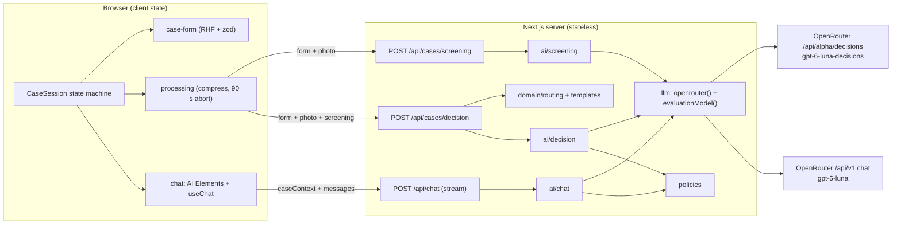
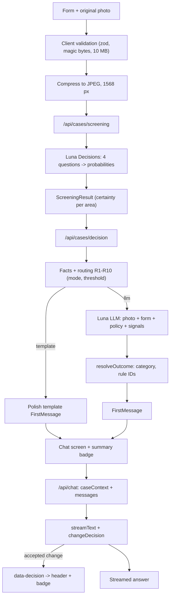
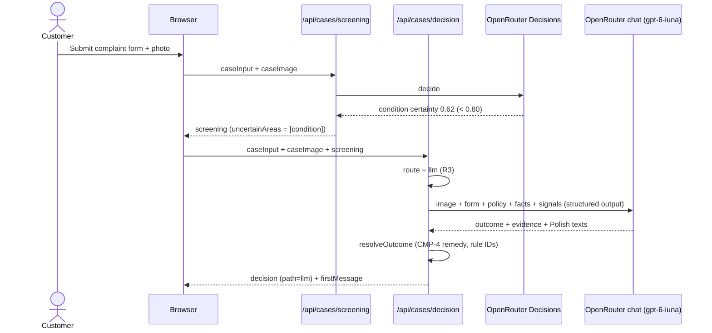
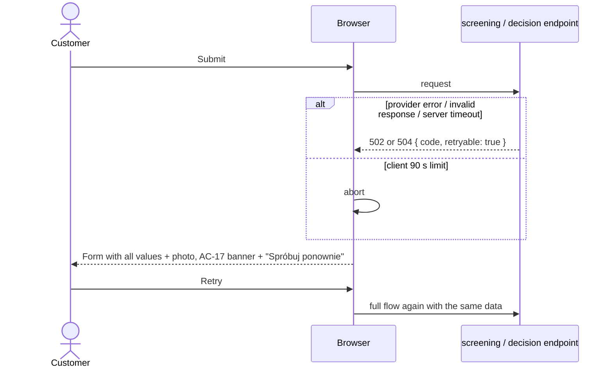
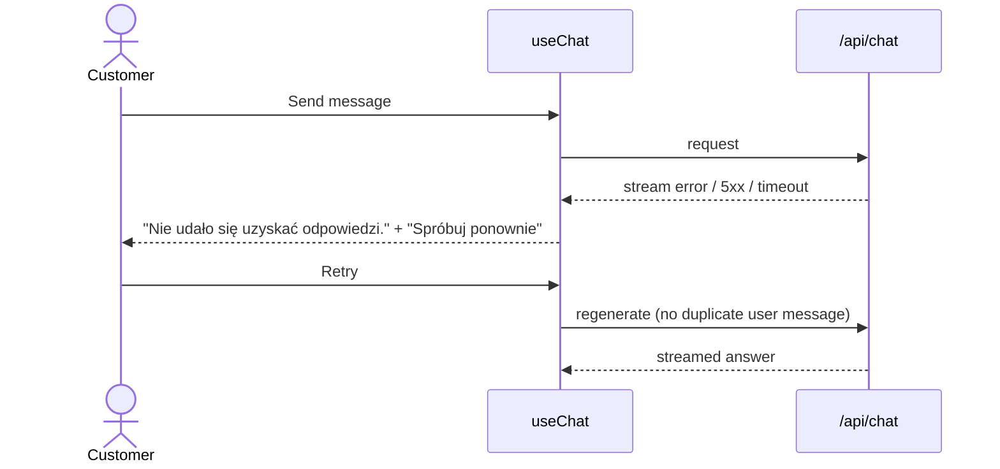

# ADR: Hardware Service Decision Copilot — Main Architecture

**Date:** 2026-11-25 (revision 2: Luna Decisions screening, AI Elements, project initialization)
**Status:** Accepted
**PRD:** [`docs/PRD.md`](../PRD.md)

Related ADRs:
- [`001-frontend.md`](001-frontend.md) — screens, client state, form, image compression, chat UI (AI Elements)
- [`002-backend-api.md`](002-backend-api.md) — route handlers, flow-to-endpoint mapping, contracts, limits, errors
- [`003-ai-decision-engine.md`](003-ai-decision-engine.md) — Luna Decisions screening, routing and threshold, LLM escalation, templates, chat agent, evaluation
- [`004-project-initialization.md`](004-project-initialization.md) — creating the app from the empty `app/` folder

---

## 1. Overview

Hardware Service Decision Copilot is a PoC web application in which a customer files a return or a complaint for an electronic device: a form plus one photo. The photo and form are first **screened** by a decision model (`openai/gpt-6-luna-decisions`, OpenRouter Decisions API) that returns calibrated probabilities for photo quality, device category, visible damage and condition. Deterministic code applies the date rules and, when every screening answer is confident (≥ 0.80 by default), produces the decision without an LLM. Otherwise the case is **escalated** to a multimodal LLM (`openai/gpt-6-luna`) that receives the photo, the form, the policy and the screening signals. The customer then continues in a streaming chat with the LLM.

This ADR set turns the PRD (what/why) into implementation decisions (how) so that an implementing agent can build the app without architectural guesses. Every PRD acceptance criterion is owned by at least one ADR.

### Decisions agreed with the user (2026-11-25)

| Topic | Decision |
|---|---|
| Stack | Next.js 16 App Router + TypeScript strict + Vercel AI SDK 7, one project in `app/` |
| Initialization | `create-next-app` with explicit flags, then shadcn/ui and AI Elements patterns (ADR-004) |
| OpenRouter access | `@openrouter/ai-sdk-provider` for both models; Responses API not used |
| Screening | `openai/gpt-6-luna-decisions` via `experimental_decide`; critical areas: photo quality, category match, damage/use, condition |
| Certainty | Top probability per answer; threshold 0.80 (env); any critical answer below → whole case escalated to the LLM |
| Decision modes | `DECISION_MODE` = `hybrid` (default) \| `decisions-only` \| `llm-always`; evaluated with `npm run eval:decisions` |
| Decision logic | Date rules, category mapping and rule-ID validation in code; LLM for escalated evidence assessment and chat |
| Session state | Client holds the case; server stateless |
| Image compression | Browser, before upload |
| Chat UI | AI Elements patterns (shadcn) driven by `useChat` |
| Testing | TDD; Vitest with HTTP-level replays of captured OpenRouter responses; Playwright E2E incl. a small live suite |
| Deployment | Local only (course VM) |
| Frontend tooling | npm, Tailwind CSS 4, shadcn/ui, react-hook-form + zod |

---

## 2. Technology Documentation References

Versions are the latest on npm on 2026-11-25; the implementing agent pins the installed versions (ADR-004) and queries docs for that major version.

| Library / API | Context7 ID or official docs | Version (2026-11-25) | Used for |
|---|---|---|---|
| Next.js | `/vercel/next.js` (versioned: `/vercel/next.js/v16.4.5`) | 16.4.x | App Router, route handlers, `create-next-app`, `next/font/local` |
| AI SDK | `/vercel/ai` (versioned: `/vercel/ai/ai_7.0.0`); docs site `/websites/ai-sdk_dev` | `ai` 7.0.x (≥ 7.0.133), `@ai-sdk/react` 4.x | `experimental_decide`, `generateText` + `Output.object`, `streamText`, tools, UI message streams, `useChat` |
| OpenRouter AI SDK provider | `/openrouterteam/ai-sdk-provider` | 3.1.x | `openrouter(id)`, `openrouter.evaluationModel(id)`, `fetch` injection, provider routing options |
| OpenRouter API docs | `/websites/openrouter_ai`; https://openrouter.ai/docs | — | Base URL, Decisions API (alpha), structured outputs, provider routing |
| AI Elements | https://ui.shadcn.com/docs/ai-elements ; legacy `/vercel/ai-elements` | patterns (no package) | Chat, Message, Prompt Input, Message Scroller |
| shadcn/ui | `/shadcn-ui/ui` | CLI 4.x | UI primitives |
| Tailwind CSS | `/tailwindlabs/tailwindcss.com` | 4.3.x | Styling, `@theme` tokens |
| Zod | `/colinhacks/zod` (versioned: `/colinhacks/zod/v4.6.7`) | 4.6.x | Shared schemas |
| React Hook Form / resolvers | `/react-hook-form/react-hook-form`, `/react-hook-form/resolvers` | 7.92.x / 7.0.x | Form |
| Vitest | `/vitest-dev/vitest` | 5.1.x | Unit, component, integration tests |
| Playwright | `/microsoft/playwright` | 1.65.x | E2E |
| Testing Library | https://testing-library.com/docs/react-testing-library/intro/ | 16.3.x | Component tests |
| date-fns | https://date-fns.org/docs/Getting-Started | 4.4.x | Plain-date arithmetic |

### Options evaluated (links read on 2026-11-25)

| Option | What the docs say | Verdict for this PRD |
|---|---|---|
| **Vercel AI SDK** (github.com/vercel/ai, ai-sdk.dev) | v7: `streamText` + `toUIMessageStream` + `createUIMessageStreamResponse` on the server, `useChat` with `DefaultChatTransport`, `regenerate`, custom `data-*` parts; images as `file` parts (bytes/base64); structured output via `generateText` + `Output.object` (`generateObject` deprecated); `experimental_decide` for decision models; `MockLanguageModelV4` for tests; Node.js 22+ | **Use** — covers streaming chat, multimodal input, structured output and Decisions in one library |
| **OpenRouter provider for the AI SDK** (openrouter.ai/docs/guides/community/vercel-ai-sdk) | Package `@openrouter/ai-sdk-provider`, `createOpenRouter({ apiKey })`, reads `OPENROUTER_API_KEY`; also exposes `evaluationModel()` for the Decisions API (`/api/alpha/decisions`) and accepts a custom `fetch` | **Use** — the only option that gives both `LLM_MODEL` and the Luna Decisions model through the AI SDK |
| **OpenRouter Responses API** (openrouter.ai/docs/api_reference/responses/overview) | OpenAI-compatible, `POST /api/v1/responses`, explicitly stateless (`store: true` / `previous_response_id` rejected), features: reasoning, tool calling, web search, structured output via `text.format` | **Not used** — stateless like our design but adds nothing the PRD needs; would bypass the provider's `useChat`/Decisions integration |
| **Chat SDK** (chat-sdk.dev) | "A TypeScript library for building chat bots that run on multiple platforms" (Slack, Teams, Google Chat, Discord, Telegram, WhatsApp); Redis state adapter; no web UI | **Not a fit** — it is not a web chat app template |
| **AI Elements** (now under ui.shadcn.com/docs/ai-elements) | Copied shadcn-style patterns (Chat, Message, Prompt Input, …), "no package to install"; old site deprecated end of November 2026 | **Use** for the chat UI (ADR-001) |
| **assistant-ui** | Thread UI + `useChatRuntime` wrapping `useChat` (ai@7); custom `data-*` part rendering not documented | Rejected (ADR-001) |

---

## 3. System Architecture

### Architecture pattern

Single Next.js application (modular monolith): one client-rendered page with three states (Form → Processing → Chat) and three stateless route handlers. External dependency: OpenRouter (Decisions API + chat completions). No database, no file storage, no auth.

### Repository structure

```
app/                                (created by create-next-app, ADR-004)
  package.json, package-lock.json, next.config.ts, tsconfig.json (strict),
  eslint.config.mjs, components.json, vitest.config.ts, playwright.config.ts,
  .env.example, AGENTS.md (generated + stack rules), README.md (course checklist + commands)
  public/                           logo, favicon
  scripts/                          capture-llm, eval-decisions
  src/
    app/                            layout, page, globals.css (@theme tokens)
      api/cases/screening/          route handler — stage 1
      api/cases/decision/           route handler — stage 2
      api/chat/                     route handler — streaming chat
    features/
      case-session/                 reducer state machine, leave-page guard
      case-form/                    form, photo field, texts
      processing/                   stage screen, submit orchestration
      chat/                         summary card, chat screen, first message, decision header
    components/ui/                  shadcn/ui primitives
    domain/                         pure TS: contracts, case-schema, dates, decision-rules, routing,
                                    templates, decision-labels, first-message, file-signature
    server/                         server-only: env, llm (provider + models), policies,
                                    ai/screening, ai/decision, ai/chat, ai/prompts/*.md, http
    fonts/                          DM Sans woff2
  tests/
    e2e/                            Playwright specs
    fixtures/llm-captures/          verbatim OpenRouter captures + metadata + model verification
  eval-reports/                     gitignored output of eval:decisions
```

`docs/policies/*.md` and `assets/example-images/` stay at repository level.

### Technology stack

| Layer | Technology | Reason |
|---|---|---|
| Runtime | Node.js 24 (VM), ≥ 22 required by AI SDK | Installed; supported |
| Framework | Next.js 16 App Router, TypeScript strict (+ `noUncheckedIndexedAccess`) | UI + API in one process; streaming route handlers |
| AI orchestration | AI SDK 7 (`ai`, `@ai-sdk/react`), exact versions | Decisions, structured output, streaming chat, tools |
| Provider | `@openrouter/ai-sdk-provider`, exact version | Both OpenRouter models, routing options, replayable `fetch` |
| Screening model | `openai/gpt-6-luna-decisions` (`DECISIONS_MODEL`) | Calibrated probabilities per question, image input, no prose |
| LLM | `openai/gpt-6-luna` (`LLM_MODEL`) | Escalated decisions with photo + chat with tools |
| UI | React, shadcn/ui, AI Elements patterns, Tailwind 4 | Accessible primitives, streaming chat patterns, brand tokens |
| Forms | react-hook-form + zod | Field-level validation, shared schema |
| Image processing | Canvas API in the browser | No dependency, before upload |
| Tests | Vitest + Testing Library + jsdom; Playwright | TDD loop + real-browser E2E |
| Persistence | None | PRD §7 |

---

## 4. Module Structure & Dependencies

| Module | Responsibility | Depends on | Used by |
|---|---|---|---|
| `domain/*` | Schemas, dates, rules, routing table, templates, labels, first message, file signatures | zod, date-fns | features, server, tests |
| `server/env` | Validate env once | zod | all server modules |
| `server/llm` | `createOpenRouter`; `getChatModel()`, `getDecisionModel()`; injectable `fetch` | AI SDK, provider, env | `server/ai/*`, scripts |
| `server/policies` | Load policy texts + rule IDs | env, fs | `server/ai/decision`, `server/ai/chat`, templates guard test |
| `server/ai/screening` | Decisions call → `ScreeningResult` | llm, prompts | `api/cases/screening`, eval script |
| `server/ai/decision` | Escalated multimodal decision | llm, policies, domain, prompts | `api/cases/decision`, eval script |
| `server/ai/chat` | Streaming chat + `changeDecision` | llm, policies, domain, prompts | `api/chat` |
| `app/api/*` | Thin HTTP adapters | server, domain | browser |
| `features/*` | Screens and client orchestration | domain, components, `@ai-sdk/react` | `app/page` |
| `components/ui` (incl. AI Elements primitives `message-scroller`, `message`, `bubble`, `input-group`) | shadcn/ui primitives, Polish strings | — | `features/*` |
| `scripts/*` | Capture and evaluation | server, domain | developers |

Direction: `features → components → (nothing server)`, `features → domain`, `app/api → server → domain`, `scripts → server → domain`. `domain` imports no Next.js, AI SDK or server code. Every `server/*` entry imports `server-only`. No cycles.

---

## 5. Data Models

All models are zod schemas in `domain/` (or `server/ai` for LLM-only shapes); nothing is persisted on the server.

- **CaseInput** — `caseType` (`return` | `complaint`), `category` (`laptop`=Laptop, `smartphone`=Smartfon, `tablet`=Tablet, `monitor`=Monitor, `tv`=Telewizor, `audio`=Słuchawki / audio, `console`=Konsola do gier, `other`=Inne — AC-03), `productName` (2–100), `purchaseDate` (`YYYY-MM-DD`), `description` (complaint 20–2000, return 0–2000).
- **CaseImage** — compressed JPEG: `mediaType` `image/jpeg`, `base64` (≤ 1.5 MB decoded), `width`, `height`. Sent to screening and decision endpoints, never to chat.
- **ScreeningResult** — per question (`photo_quality`, `observed_category`, `visible_damage_or_use`, `condition`): value, probabilities, certainty, confident flag, refused flag, provider confidence; `uncertainAreas`; model, prompt version, cost, latency (ADR-003 §4).
- **DeterministicFacts** — `today`, `daysSincePurchase`, `withinReturnWindow`, `withinWarranty`, `withinDeadOnArrival`.
- **Route** — template (rule R1–R10, category, rule IDs) or llm (rule, uncertain areas, optional fixed category).
- **DecisionResult** — `category` (one of 6: `return_accepted`, `return_rejected`, `complaint_accepted_repair`, `complaint_accepted_replacement_or_refund`, `complaint_rejected`, `manual_review`), `label`, `citedRuleIds`, `justification`, `photoFindingsSummary`, `nextSteps`, `manualReviewKind`, `decisionPath` (`template` | `llm`), `routeRule`, `mode`.
- **FirstMessage** — `greeting`, `decisionLabel`, `justification`, `photoFindings`, `nextSteps[]`, `notice` (AC-26 constant); canonical text rendering for the chat context.
- **ChatMessage** — AI SDK UI message; custom `data-decision` part `{ category, label, citedRuleIds, manualReviewKind }`.
- **CaseSession** (client) — state, stage, case input, original file, compressed image, screening, decision history, first message, LLM findings, processing error.

---

## 6. API / Interface Contracts

Full contracts in ADR-002.

| PRD flow step | UI | Endpoint | Output | External call |
|---|---|---|---|---|
| Form submit → photo analysis | Processing: "Analizujemy zdjęcie…" | `POST /api/cases/screening` | `{ screening }` | Decisions API (`DECISIONS_MODEL`), 25 s |
| Decision | Processing: "Przygotowujemy decyzję…" | `POST /api/cases/decision` | `{ decision, firstMessage }` | None (template) or chat completions with image (`LLM_MODEL`), 50 s |
| Chat | Chat screen (AI Elements + `useChat`) | `POST /api/chat` | UI message stream (+ `data-decision`) | Streaming chat completions (`LLM_MODEL`), 60 s |

Error envelope: `{ error: { code, retryable } }`; UI maps every processing failure to AC-17 and every chat failure to AC-37.

---

## 7. Environment Variables

| Variable | Purpose | Required | Example value |
|---|---|---|---|
| `OPENROUTER_API_KEY` | OpenRouter key for both models (server only) | Yes | `sk-or-v1-…` |
| `LLM_MODEL` | Multimodal LLM for escalated decisions and chat (must support image input, structured outputs, tools) | Yes | `openai/gpt-6-luna` |
| `DECISIONS_MODEL` | Decision model for screening (Decisions API, image input) | Yes | `openai/gpt-6-luna-decisions` |
| `DECISION_MODE` | `hybrid` \| `decisions-only` \| `llm-always` | No (default `hybrid`) | `hybrid` |
| `DECISIONS_CONFIDENCE_THRESHOLD` | Minimum certainty (0.5–0.99) for a screening answer to count as confident | No (default `0.80`) | `0.80` |
| `POLICIES_DIR` | Folder with the policy files | No (default `../docs/policies`) | `../docs/policies` |
| `APP_TIME_ZONE` | IANA zone for "today" | No (default `Europe/Warsaw`) | `Europe/Warsaw` |

The root `.env.example` currently lists `OPENROUTER_API_KEY` and `LLM_MODEL`; the implementing agent adds `DECISIONS_MODEL` there and creates `app/.env.example` with all variables. No `NEXT_PUBLIC_` variables.

---

## 8. Technical Decisions

### Next.js App Router + Vercel AI SDK 7 in one project
**Status:** Accepted
**Date:** 2026-11-25
**Context:** The PoC needs upload, a decision pipeline with structured output, and a streaming chat, built by agents with TDD.
**Decision:** One Next.js 16 project; AI SDK 7 for decisions, structured output and streaming; `useChat` on the client.
**Rejected alternatives:**
- Vite + Express: two processes, no PoC benefit.
- Next.js + Mastra: Phase 2 concerns (memory, RAG).
- FastAPI + React: schemas could not be shared.
**Consequences:**
- (+) Shared zod types across client, server, tests.
- (-) AI SDK APIs change between majors; `experimental_decide` may change in patches → exact pinning (ADR-004).
**Review trigger:** Phase 2 needs durable agent memory or RAG.

### Two OpenRouter models: Luna Decisions for screening, Luna for reasoning and chat
**Status:** Accepted
**Date:** 2026-11-25 (supersedes "One OpenRouter model for all three AI tasks")
**Context:** The user wants a calibrated, cheap pre-check before the multimodal LLM and the option to skip the LLM when certainty is high.
**Decision:** `DECISIONS_MODEL` screens every case; `LLM_MODEL` handles escalations and chat. Both through `@openrouter/ai-sdk-provider` with `data_collection: deny`.
**Rejected alternatives:**
- One LLM for everything (previous revision): no calibrated certainty, LLM cost on every case.
- Decision model only: cannot chat or explain complex complaints.
**Consequences:**
- (+) Certainty per area; LLM-free decisions for clear cases.
- (-) Two models to verify and monitor; Decisions API is alpha; model page returned 404 during research (TAC-003-07 gate).
**Review trigger:** Evaluation report shows screening adds latency without reducing escalations.

### Hybrid decision: code rules, screening router, LLM escalation
**Status:** Accepted
**Date:** 2026-11-25
**Context:** AC-20..AC-22 require exact date math and AC-16/AC-18/AC-19 a closed category set; photo judgments are probabilistic.
**Decision:** Code computes facts, applies R1–R10 (ADR-003 §3.3), maps abstract outcomes to categories and validates rule IDs; templates write LLM-free decisions; the LLM decides only escalated cases.
**Rejected alternatives:**
- Everything in the LLM: non-deterministic date/category ACs.
- Everything in code: visual and description judgments need models.
**Consequences:**
- (+) Date, category and routing ACs covered by deterministic unit tests.
- (-) Templates duplicate policy facts in Polish (guarded by a test).
**Review trigger:** Real policies replace the fictional ones.

### OpenRouter via AI SDK provider instead of the Responses API
**Status:** Accepted
**Date:** 2026-11-25
**Context:** OpenRouter offers chat completions, a stateless Responses API and the Decisions API.
**Decision:** Provider for everything (details in ADR-002).
**Rejected alternatives:** Responses API directly; raw HTTP.
**Consequences:** (+) One client, one test replay mechanism. (-) Dependent on provider updates for the alpha Decisions API.
**Review trigger:** Need for web search or encrypted reasoning continuation.

### Stateless server, client-held case
**Status:** Accepted
**Date:** 2026-11-25
**Context:** No persistence (PRD §7, AC-39).
**Decision:** The browser holds the case; requests carry the context; the server recomputes facts each time.
**Rejected alternatives:** In-memory server sessions.
**Consequences:** (+) Simple restart and tests. (-) A customer could tamper with screening or history in requests; accepted because decisions are preliminary (AC-26) and the form is trusted per PRD §7; all inputs are schema-validated and size-limited.
**Review trigger:** Phase 2 persistence or binding decisions.

### Local-only deployment
**Status:** Accepted
**Date:** 2026-11-25
**Context:** Demo on course VMs.
**Decision:** `npm run dev`, `npm run build` + `npm run start`; handlers declare `maxDuration` for future serverless use.
**Rejected alternatives:** Docker, Vercel.
**Consequences:** (+) No infra work. (-) No public URL.
**Review trigger:** Demo outside the VM.

---

## 9. Diagrams

### 9.1 Architecture / Component Diagram



### 9.2 Data Flow Diagram



### 9.3 Sequence Diagrams

#### Case submission — template route (no LLM)

```mermaid
sequenceDiagram
  actor C as Customer
  participant UI as Browser
  participant S as /api/cases/screening
  participant D as /api/cases/decision
  participant OD as OpenRouter Decisions
  C->>UI: Submit valid return form + photo
  UI->>UI: compress, stage "Analizujemy zdjęcie…", start 90 s timer
  UI->>S: caseInput + caseImage
  S->>OD: experimental_decide(state: text, json, image; 4 questions)
  OD-->>S: probabilities (all >= 0.80)
  S-->>UI: screening
  UI->>UI: stage "Przygotowujemy decyzję…"
  UI->>D: caseInput + caseImage + screening
  D->>D: facts + route = template (R8)
  D-->>UI: decision (path=template) + firstMessage
  UI->>UI: Chat screen with structured first message
```

#### Case submission — escalation to the LLM



#### Processing failure or timeout



#### Chat with decision change

```mermaid
sequenceDiagram
  actor C as Customer
  participant UI as useChat + AI Elements
  participant H as /api/chat
  participant M as OpenRouter chat (gpt-6-luna)
  C->>UI: "Telefon raz spadł na podłogę"
  UI->>H: caseContext + messages
  H->>M: streamText(system: policy, facts, signals, decision; tool changeDecision)
  M-->>H: changeDecision(rejected, [RET-5, RET-2])
  H->>H: resolveOutcome -> return_rejected
  H-->>UI: data-decision
  M-->>H: streamed justification
  H-->>UI: text parts
  UI->>UI: "Zmiana decyzji: Zwrot odrzucony" + notice + badge update
```

#### Chat failure and retry



---

## 10. Testing Strategy

### Philosophy

TDD per `AGENTS.md`: tests from PRD ACs and these ADRs first, red for the expected reason, then green. Deterministic logic (dates, routing R1–R10 × modes, mapping, templates, schemas) carries most ACs and is tested exhaustively. Both OpenRouter models are replaced in unit/integration tests by an injected `fetch` that replays **captured real HTTP responses** (`npm run capture:llm`, metadata with date, endpoint, model, prompt version). Frontend component tests replay our own API responses recorded from the running app (`tests/fixtures/api-captures/`). No double is ever written from documentation. A live E2E suite (real app, real OpenRouter, no request interception) exercises every endpoint, decision path and mode and asserts stable properties only (plan §7a). `npm run eval:decisions` compares decision modes and informs the threshold. Every task ends with Manual QA through the Playwright CLI.

### Test layers

| Layer | Type | Scope | Tools |
|---|---|---|---|
| Unit | Pure functions | `domain/*`, certainty computation, prompt assembly, policy parser, template guard | Vitest (node) |
| Component | Rendering + interaction | Form, processing, chat (AI Elements customized), summary, dialogs | Vitest + Testing Library + jsdom |
| Integration | Handlers + services with HTTP replays | Three endpoints, both models, all modes | Vitest (node), injected `fetch` |
| E2E (no LLM) | Real stack, no request interception | Validation, layout, keyboard on the Form screen (nothing that needs a submitted case) | Playwright |
| E2E (live) | Real stack + real OpenRouter (both models), no interception | L1–L12 (plan §7a; L1–L6 detailed in ADR-003 §8), runs per `DECISION_MODE` and an invalid-key run | Playwright live project |
| Evaluation | Offline report | Photos × synthetic forms × 3 modes | `npm run eval:decisions` |
| Manual QA | Human-like | Every touched screen + brand comparison | Playwright CLI |

### Key test scenarios

1. **Return outside window** — day 15 → template "Zwrot odrzucony", RET-1, day count in text (AC-20); day 14 not forced.
2. **Complaint outside warranty** — 24 months + 1 day → template "Reklamacja odrzucona", CMP-1 (AC-21); leap-day purchase.
3. **Complaint remedy** — accepted at day 30 → replacement/refund; day 31 → repair (AC-22).
4. **Photo gate** — confident `photo_quality = too_dark` → template manual review with ≥ 2 tips (AC-23).
5. **Category mismatch** — form laptop, observed smartphone (confident) → manual review better photo.
6. **Threshold** — certainty 0.79 on any critical answer → escalation (hybrid), manual review (decisions-only); 0.80 → confident.
7. **Mode matrix** — same screening fixture through all three modes yields the paths in ADR-003 §3.3.
8. **Refusal** — refused screening question → escalation, not an error.
9. **Category isolation** — no route or tool can produce a cross-type category (AC-16).
10. **Processing failure** — screening 502 → form preserved, AC-17 banner, retry (AC-17).
11. **Chat** — context answers (AC-32), decision change via tool (AC-33), refusal under pressure (AC-34), off-topic (AC-35), retry without duplicates (AC-37).

### Technical acceptance criteria

- TAC-01: `npm run lint`, `typecheck`, `test` pass with zero errors and warnings.
- TAC-02: `npm run build` succeeds; `npm run start` serves the app on `http://localhost:3000`.
- TAC-03: `domain/` ≥ 95 % line/branch coverage overall and 100 % branch coverage for `routing`, `decision-rules`, `dates`; `domain/` imports nothing from `server/`, `features/`, `next` or `ai`.
- TAC-04: No client bundle contains `OPENROUTER_API_KEY`, `server/` modules or policy contents (search `.next/static` after build).
- TAC-05: Every capture in `tests/fixtures/llm-captures/` has metadata referencing the current prompt version.
- TAC-06: `npm run test:e2e:live` passes L1–L12 (plan §7a) with the configured models; E2E and Manual QA use no request interception and the app has no test-only bypass flags.
- TAC-07: Every `DecisionResult` has a category of the case type, non-empty valid rule IDs, and `decisionPath`/`routeRule`/`mode` set.
- TAC-08: Server logs contain no photo bytes, description text or chat text.
- TAC-09: Both models pass the pre-implementation verification (TAC-003-07) before any feature code is written.
