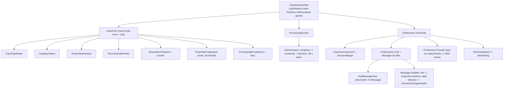
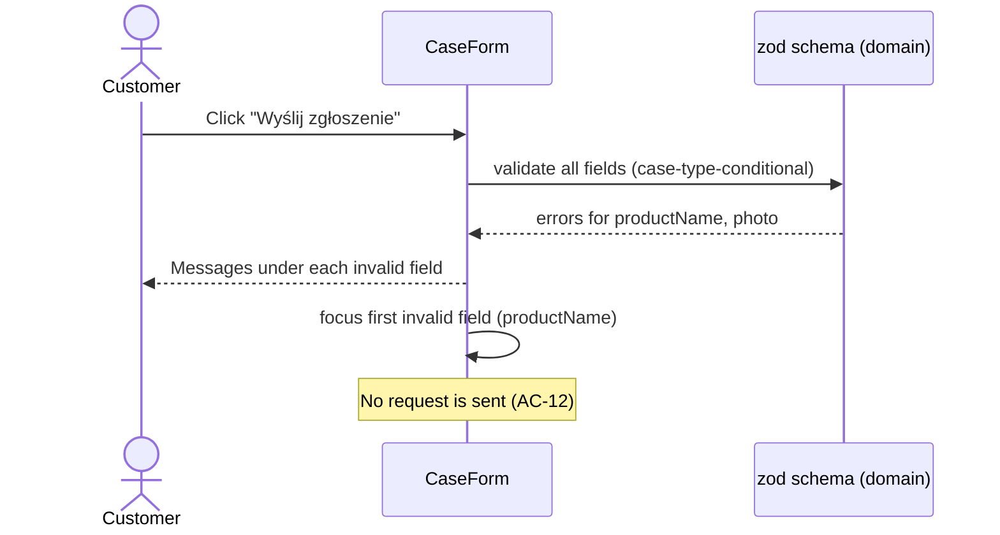
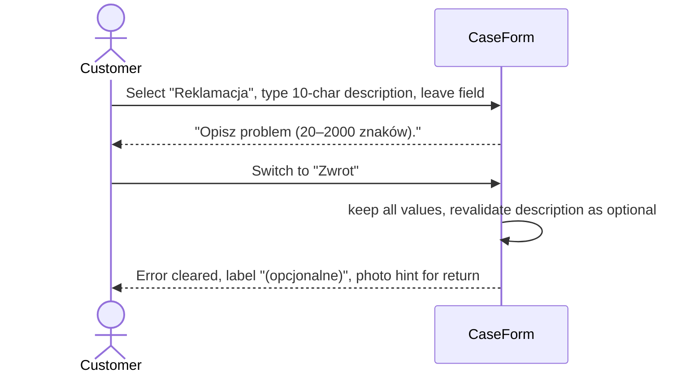

# ADR-001: Frontend — Screens, Client State, Form, Image Compression, Chat UI

**Date:** 2026-11-25
**Status:** Accepted
**Relates to:** [`000-main-architecture.md`](000-main-architecture.md), PRD §4, §6 (AC-01..AC-17, AC-25..AC-42), §9

---

## 1. Scope

Covers everything that runs in the browser: the single page with the Form, Processing and Chat states, client-side session state, form validation, photo validation and compression, calls to the API, chat rendering and streaming, accessibility, responsiveness and brand styling.

Not covered: request/response contracts and server limits (ADR-002), prompts, rules and decision logic (ADR-003).

---

## 2. Technology Documentation References

| Library | Context7 ID or official docs | Used for |
|---|---|---|
| Next.js | `/vercel/next.js` | App Router page, `next/font/local`, client components |
| AI SDK UI | `/vercel/ai` | `useChat`, `DefaultChatTransport` with `prepareSendMessagesRequest`, `regenerate`, `status`, custom data parts |
| AI Elements | https://ui.shadcn.com/docs/ai-elements (current home); legacy `/vercel/ai-elements` | Chat (formerly Conversation), Message, Prompt Input patterns, Message Scroller, shimmer/spinner |
| assistant-ui (evaluated, not used) | https://www.assistant-ui.com/docs/runtimes/ai-sdk/v7 | Comparison in §6 |
| shadcn/ui | `/shadcn-ui/ui` | Radio group, select, popover + calendar (date picker), textarea, button, alert, badge, alert dialog, card, collapsible |
| Tailwind CSS | `/tailwindlabs/tailwindcss.com` | `@theme` variables generated from `assets/design-tokens.json` |
| React Hook Form | `/react-hook-form/react-hook-form` | Form state, `shouldFocusError`, `mode: onTouched` |
| RHF resolvers | `/react-hook-form/resolvers` | zod resolver |
| Zod | `/colinhacks/zod` | Shared `CaseInput` schema with Polish messages |
| Markdown rendering | Renderer shipped with the AI Elements Message pattern (fallback: https://github.com/remarkjs/react-markdown) | Agent answer rendering, raw HTML disabled |
| Canvas / createImageBitmap | https://developer.mozilla.org/en-US/docs/Web/API/Window/createImageBitmap | EXIF-aware decode and resize |

---

## 3. Component Design

### Page and state machine

`app/page` renders one client component `CaseSessionRoot`, which owns a reducer-based state machine (no global store library):

| State | Shows | Transitions |
|---|---|---|
| `form` | Form screen; optional processing-error banner | valid submit → `processing` |
| `processing` (stage `image` → `decision`) | Processing screen | success → `chat`; failure/timeout → `form` with banner |
| `chat` | Case summary + conversation + input | confirmed "Nowe zgłoszenie" → `form` (empty) |

The reducer keeps `caseInput`, the original `File`, the compressed `CaseImage`, the thumbnail object URL, `screening`, `decisionHistory`, `firstMessage`, `llmFindings` (escalated cases only) and the processing error. Form values stay mounted in the reducer during `processing` so a failure restores them exactly (AC-17). Object URLs are revoked when the photo is replaced, removed or the session is reset.

**Leave-page guard (AC-39):** a `beforeunload` listener is registered while the form has any value, while processing, and in chat; it is removed after reset to an empty form. After reload the state is the initial empty form (nothing written to storage — no `localStorage`/`sessionStorage`).

### Form screen (`features/case-form`)

- Fields in PRD §9.1 order: case type (radio group rendered as two large options, no default — AC-02), category (select, no default, AC-03 labels), name/model (input), purchase date (shadcn date picker: popover + calendar, Polish locale, dates after today and before today−10 years disabled; typed input is also validated — AC-05), description (textarea with counter; label suffix "(wymagane)" for complaint, "(opcjonalne)" for return, neutral before a type is chosen — AC-06, AC-07), photo field, AI notice (AC-11), submit "Wyślij zgłoszenie".
- Validation: one zod schema from `domain/case-schema`, conditional on `caseType`, producing the exact Polish messages from AC-04..AC-08. React Hook Form `mode: onTouched` (validate on leaving a field) and `shouldFocusError: true` (focus first invalid field on submit — AC-12). Changing case type keeps all values and re-runs description validation if the field was touched (AC-13).
- "Today" for the date picker is the browser's local date; the server recomputes facts in `APP_TIME_ZONE` (difference documented in §6).

### Photo field

- Drop zone + "Wybierz plik" button; keyboard operable; single file only.
- Hint above the field depends on case type (AC-10).
- Validation order: (1) size ≤ 10 MB of the original file → else "Zdjęcie przekracza limit 10 MB."; (2) format by **magic bytes** (JPEG `FF D8 FF`, PNG `89 50 4E 47 0D 0A 1A 0A`, WEBP `RIFF....WEBP`) via `domain/file-signature`; anything else → "Dozwolone formaty: JPG, PNG, WEBP." The file extension and `File.type` are ignored for the decision because example fixtures include a JPEG named `laptop-1.png`.
- After a valid selection: thumbnail, file name, "Zmień" and "Usuń" actions (AC-09).

### Image compression (`lib/compress-image`)

- Runs only after a valid submit (not on selection), inside the processing flow, invisible to the user (AC-15).
- Decode with `createImageBitmap(file, { imageOrientation: 'from-image' })` so EXIF rotation is applied; scale so the longer edge is ≤ 1568 px (never upscale); draw on a canvas; encode JPEG quality 0.85; if the result exceeds 1.5 MB, re-encode at 0.7, then at 1280 px long edge. Output `CaseImage { mediaType: image/jpeg, base64, width, height }`.
- Decode failure (corrupt file with a valid signature) → treated as a processing failure (banner + retry, AC-17).

### Processing screen (`features/processing`)

- Replaces the form content; shows thumbnail, an indeterminate progress indicator, current stage text ("Analizujemy zdjęcie…" → "Przygotowujemy decyzję…") and "To może potrwać do minuty." (AC-14, PRD §9.2). Submit is not rendered/disabled; no cancel.
- Orchestration: one `AbortController` with a 90 000 ms timer covers compression + both requests (AC-17). Stage `image` ("Analizujemy zdjęcie…") = `POST /api/cases/screening` (Luna Decisions). Stage `decision` ("Przygotowujemy decyzję…") = `POST /api/cases/decision` with `caseInput`, the same compressed image and the returned `screening`; the server decides whether a template or the LLM produces the decision (ADR-003). The UI behaves identically for both routes.
- Stage text is in an `aria-live="polite"` region.

### Chat screen (`features/chat`)

- **Case summary card** (AC-29): case type, category label, name/model, purchase date formatted `dd.MM.yyyy`, thumbnail (click/Enter opens an enlarged view in a dialog), decision badge from the **latest** entry in `decisionHistory`. Badge variants: accepted (success token), rejected (error token), manual review (neutral/accent token). Collapsible on viewports < 768 px.
- **First message** (AC-25..AC-28): rendered from the structured `FirstMessage` with fixed components in fixed order — greeting paragraph, decision label (bold, badge style), justification, heading "Co widzimy na zdjęciu", heading "Kolejne kroki" + ordered list, notice paragraph. No Markdown parsing for this message.
- **Agent answers**: text parts rendered with the Message pattern's Markdown renderer (no raw HTML, links open in new tab with `rel="noopener noreferrer"`). When a message contains a `data-decision` part, it is rendered first as a header "Zmiana decyzji: <label>" (bold), then the text, then the AC-26 notice (AC-33, PRD §11.2).
- **Customer messages** right-aligned, agent messages left-aligned; auto-scroll to newest message unless the user scrolled up.
- **Input**: textarea, placeholder "Zadaj pytanie lub dodaj informacje…", Enter sends, Shift+Enter newline, counter shown from 900 characters, > 1000 characters shows "Wiadomość może mieć maksymalnie 1000 znaków." and blocks sending; Send disabled for whitespace-only input and while `status` is `submitted` or `streaming` (AC-30, AC-31). No attachment control (AC-36).
- **Typing indicator** while `status === 'submitted'`; streamed text appears progressively during `streaming` (AC-31).
- **Errors** (AC-37): when `useChat` reports an error, the failed customer message stays, and under it "Nie udało się uzyskać odpowiedzi." + "Spróbuj ponownie", which calls `regenerate()` (resends without adding a duplicate user message). Any partial assistant text from the failed attempt is discarded.
- **"Nowe zgłoszenie"** button in the chat header (AC-38): opens an alert dialog "Obecna rozmowa zostanie utracona. Kontynuować?" with confirm/cancel; confirm resets the reducer and the `useChat` instance (new chat id). The button uses the primary (emphasized) variant when the latest decision is manual review with `manualReviewKind = better_photo`, otherwise secondary.

### Chat components (AI Elements)

The Chat screen is assembled from AI Elements patterns (copied, owned code in `src/components/ai-elements/`, see ADR-004 step 8) driven by `useChat`:

| UI element | AI Elements pattern | Our customization |
|---|---|---|
| Scrollable conversation with auto-scroll and "scroll to bottom" | Chat (formerly Conversation) + Message Scroller | Polish aria labels; no empty state (first message always present) |
| Agent / customer bubbles | Message (`from` = role) | Agent left, customer right; brand tokens |
| Streaming Markdown of agent answers | Message's response renderer | Raw HTML disabled; links `rel="noopener noreferrer"` |
| First message | Not a pattern — own `FirstMessageView` inside a Message bubble | Structured sections (AC-25) |
| Decision change header | Own `DecisionChangeHeader` rendered for the `data-decision` part in the `part.type` switch | "Zmiana decyzji: <label>" + notice (AC-33) |
| Input | Prompt Input (textarea + submit with `status`) | Attachments removed (AC-36); 1000-char limit and counter; Enter/Shift+Enter; Polish placeholder |
| Typing indicator | Spinner / shimmer utility | Shown while `status === 'submitted'` |
| Error + retry | Own inline component | AC-37 text, calls `regenerate()` |

All English default strings in copied components are replaced with Polish (AC-40). Rendering message parts follows the documented pattern: switch on `part.type` — `text` → response renderer, `data-decision` → header, anything else → nothing.

### Chat transport

`useChat` with `DefaultChatTransport` to `/api/chat`; `prepareSendMessagesRequest` sends `{ caseContext, messages }` where `caseContext` comes from the reducer (`caseInput`, `screening`, `decisionHistory`, `firstMessage`, `llmFindings`). The first assistant message is **not** part of `useChat` messages sent as UI parts; the server renders it from `firstMessage` (ADR-002). On each received `data-decision` part the reducer appends to `decisionHistory`.

### Layout, brand and accessibility

- Header on all screens: logo (`assets/logo.svg` copied to `app/public/`) + product name "Hardware Service Decision Copilot" (PRD §9).
- Single centered column, max width ~720 px for the form, ~840 px for chat; 16 px side gutter; no horizontal scroll from 360 px to 1920 px (AC-41).
- Tokens: `assets/design-tokens.json` is translated once into Tailwind `@theme` CSS variables in `globals.css` (colors, typography, spacing, radii, shadows); shadcn component variables map to these tokens. DM Sans is loaded with `next/font/local` from files copied into `app/src/fonts/`. The Blank Theme icon font is not used (per `docs/design-guidelines.md`); icons come from `lucide-react` (shadcn default).
- Every input has a visible `<label>`; errors are linked with `aria-describedby` and announced; all actions are reachable by Tab and operable by Enter/Space; visible focus ring; dialogs trap focus (AC-42).
- All UI strings are Polish and kept in one module `features/*/texts` per feature (AC-40); no i18n library.

---

## 4. Data Structures

- `CaseFormValues` — form shape; `purchaseDate` held as `Date | undefined` in the picker and serialized to `YYYY-MM-DD` for the API.
- `CaseSessionState` — `{ state, processingStage, caseInput, originalFile, caseImage, thumbnailUrl, screening, decisionHistory[], firstMessage, llmFindings, processingError: null | 'processing_failed' }`.
- `DecisionBadgeVariant` — derived: `accepted` | `rejected` | `manual_review` from `DecisionResult.category`.
- `CaseUIMessage` — AI SDK UI message type parameterized with the data part `decision: { category, label, citedRuleIds }`.

---

## 5. Interface Contracts

The frontend consumes (details in ADR-002):

| Call | When | Success handling | Failure handling |
|---|---|---|---|
| `POST /api/cases/screening` | Stage 1 after compression | Store `screening`, switch stage | Any non-2xx, network error, abort → `form` + banner |
| `POST /api/cases/decision` | Stage 2 (sends `caseInput`, `caseImage`, `screening`) | Store decision + first message (+ LLM findings), go to `chat` | Same as above |
| `POST /api/chat` (stream) | Each send / retry | Append streamed parts; apply `data-decision` | `useChat` error → inline error + retry |

UI never shows server error codes; it maps every processing failure to the AC-17 text and every chat failure to the AC-37 text.

---

## 6. Technical Decisions

### Single page with a reducer state machine
**Status:** Accepted
**Date:** 2026-11-25
**Context:** PRD §9.4 defines three states with no back navigation and no persistence; reload must clear everything.
**Decision:** One route (`/`) and a `useReducer` state machine. No URL routing per screen, no global store library.
**Rejected alternatives:**
- Separate routes (`/`, `/chat`): enables back navigation and deep links the PRD excludes; state would have to survive navigation.
- Zustand/Redux: unnecessary for one component tree.
**Consequences:**
- (+) Reload naturally resets to the empty form (AC-39).
- (-) Browser back button leaves the app; acceptable with the leave-page guard.
**Review trigger:** Phase 2 adds persisted cases with shareable URLs.

### Browser-side compression to JPEG, 1568 px long edge
**Status:** Accepted
**Date:** 2026-11-25
**Context:** AC-15 requires compression without user action; originals up to 10 MB would slow upload and inflate model input cost.
**Decision:** Canvas-based resize/encode as described in §3. 1568 px keeps enough detail for scratches while staying within typical vision-model input sizes.
**Rejected alternatives:**
- `browser-image-compression` library: adds a dependency and a web worker for a task the Canvas API covers.
- Server-side `sharp`: requires uploading the full original and larger body limits.
**Consequences:**
- (+) Upload ≤ 1.5 MB; uniform JPEG input for the model.
- (-) Very fine damage might be lost on huge originals; WEBP/PNG transparency is flattened (white background).
**Review trigger:** Live E2E or Manual QA shows the model missing damage visible in the original.

### Magic-byte format validation
**Status:** Accepted
**Date:** 2026-11-25
**Context:** AC-08 accepts JPG/PNG/WEBP. `File.type` is derived from the extension; fixture `laptop-1.png` is actually a JPEG.
**Decision:** Accept or reject based on the file signature only; the same function runs on the server for the compressed image.
**Rejected alternatives:**
- Extension or `File.type` check: wrong for mislabeled files, trivially spoofable.
**Consequences:**
- (+) `laptop-1.png` is accepted (it is a JPEG, an allowed format).
- (-) HEIC from iPhones is rejected with the AC-08 message; acceptable per PRD.
**Review trigger:** Customers frequently upload HEIC.

### AI Elements patterns for the chat UI
**Status:** Accepted
**Date:** 2026-11-25
**Context:** The chat needs streaming rendering, auto-scroll, a prompt input bound to `useChat` status, a custom data part and a structured first message, styled with the brand tokens and fully in Polish.
**Decision:** Use AI Elements patterns (Chat, Message, Prompt Input, Message Scroller) as owned shadcn-style code, driven directly by `useChat`. AI Elements is moving to shadcn/ui (the old site is announced as deprecated at the end of November 2026), so patterns come from https://ui.shadcn.com/docs/ai-elements, with the legacy registry only as a fallback (ADR-004).
**Rejected alternatives:**
- assistant-ui: complete Thread UI with an `useChatRuntime` wrapper over `useChat` (ai@7 supported), but adds a runtime layer and state library, and its docs do not describe rendering custom `data-*` parts — our decision header depends on that.
- Fully custom components on `useChat`: maximal control, but re-implements streaming Markdown, scroll anchoring and input states that the patterns already solve.
- Chat SDK: a multi-platform bot library without a web UI.
**Consequences:**
- (+) Components work with `useChat` parts as documented; we own and adapt the code.
- (+) Same shadcn/Tailwind token system as the form.
- (-) Copied code does not receive upstream fixes automatically; the source used is recorded in `app/README.md`.
**Review trigger:** Phase 2 needs thread lists, persistence or attachments — re-evaluate assistant-ui.

### Structured first message, Markdown only for chat answers
**Status:** Accepted
**Date:** 2026-11-25
**Context:** AC-25 fixes the order of sections and AC-26 fixes the notice text; LLM-generated Markdown cannot guarantee either.
**Decision:** The first message is rendered from structured fields; free-form agent answers use the Message pattern's Markdown renderer without raw HTML.
**Rejected alternatives:**
- Render LLM Markdown for the first message: order and notice could drift.
**Consequences:**
- (+) AC-25/AC-26 testable with component tests.
- (-) Two rendering paths for agent messages.
**Review trigger:** None expected in the PoC.

---

## 7. Diagrams

### Component diagram

### Sequence — form submit with validation errors

### Sequence — switching case type keeps values

---

## 8. Testing Strategy

### Test scenarios for this area

| Scenario | Type | Input | Expected output | Edge cases |
|---|---|---|---|---|
| Form fields and options | Component | Render form | Exactly 6 fields; 2 case types, 8 categories, none preselected (AC-01..AC-03) | — |
| Name/model length | Unit (schema) + component | "A", 2 chars, 100 chars, 101 chars, spaces only | Message from AC-04 for 1, 101 and whitespace | Trimming |
| Purchase date bounds | Unit + component | tomorrow, today, today−10y, today−10y−1d | Future/too-old messages from AC-05 | Leap day |
| Description by type | Unit + component | complaint 19/20/2000/2001 chars; return empty/2000/2001 | AC-06/AC-07 messages and labels | Type switch after error (AC-13) |
| Photo validation | Unit (signature) + component | `laptop-1.png` (JPEG bytes), `laptop-2.webp`, a `.gif`, a renamed `.txt`, an 11 MB file | Accept first two; AC-08 messages for others | Exactly 10 MB accepted |
| Photo thumbnail actions | Component | Select, "Zmień", "Usuń" | Thumbnail + name; replaced/removed; object URL revoked | — |
| Photo hint and AI notice | Component | Switch type | AC-10 hint per type; AC-11 notice above submit | No type selected → no hint |
| Submit invalid | Component | Two invalid fields | No fetch; messages; focus on first invalid (AC-12) | — |
| Compression | Unit (jsdom canvas mocked) + E2E | 3024×3135 JPEG | Output JPEG ≤ 1568 px long edge, ≤ 1.5 MB | Small image not upscaled |
| Processing stages | Component (fetch stubbed with delays) | Valid submit | "Analizujemy zdjęcie…" during `/api/cases/screening`, then "Przygotowujemy decyzję…" during `/api/cases/decision`; submit disabled (AC-14) | Decision request carries the screening from stage 1 |
| Prompt Input customization | Component | Render chat | No attachment button; Polish placeholder and labels | — |
| Processing failure | Component | Stage 1 or 2 returns 502; or 90 s elapses (fake timers) | Form with values + photo, AC-17 banner; retry resubmits same data | Failure in stage 2 |
| First message order | Component | Fixture `FirstMessage` | Sections in AC-25 order, AC-26 notice, no raw `*`/`#` visible | — |
| Case summary | Component | Fixture case | All AC-29 fields, badge variant per category | Mobile collapsed |
| Chat input limits | Component | "", "   ", 1000, 1001 chars | Send disabled / AC-30 message | Enter vs Shift+Enter |
| Streaming state | Component (transport stub streaming chunks) | Send message | Typing indicator, progressive text, send disabled (AC-31) | — |
| Decision change render | Component | Stream with `data-decision` part | "Zmiana decyzji: <label>" header, notice, badge updated (AC-33) | Two changes in a row |
| Chat error retry | Component | Transport errors once then succeeds | Error text + retry; one user message after retry (AC-37) | Partial text discarded |
| New case dialog | Component | Confirm / cancel | Empty form / unchanged chat (AC-38) | Emphasized variant for better-photo case |
| Leave-page guard | Component + E2E | Filled form, reload | `beforeunload` registered; after reload empty form (AC-39) | Not registered on empty form |
| Responsive + keyboard | E2E (no LLM) + Manual QA | 360, 768, 1920 px; Tab-only navigation | No horizontal scroll; every action reachable (AC-41, AC-42) | Date picker by keyboard |

### Technical acceptance criteria

- TAC-001-01: All Polish UI strings from PRD §6 appear verbatim in `features/*/texts` and are asserted by at least one component test each.
- TAC-001-02: No `localStorage`, `sessionStorage`, IndexedDB or cookie writes exist in client code.
- TAC-001-03: The image sent to `/api/cases/screening` and `/api/cases/decision` is always `image/jpeg`, long edge ≤ 1568 px, decoded size ≤ 1.5 MB.
- TAC-001-04: Playwright accessibility scan (axe) on Form and Chat screens reports zero serious or critical violations.
- TAC-001-05: Page width equals viewport width (no horizontal scroll) at 360 px and 1920 px on Form, Processing and Chat screens.
