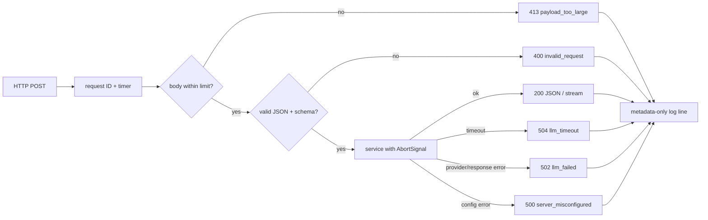
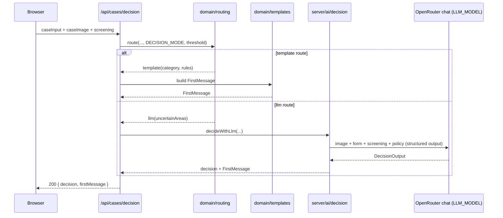
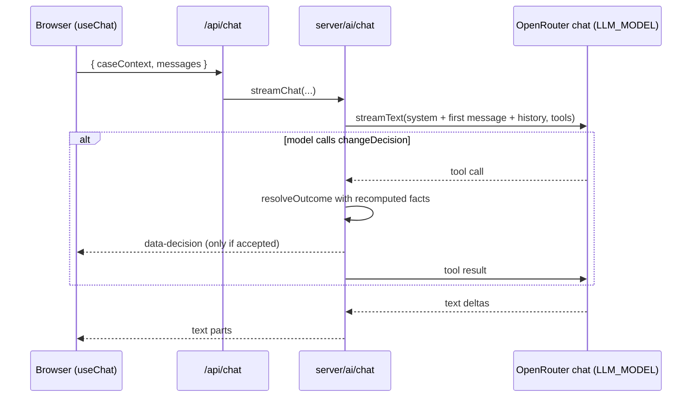

# ADR-002: Backend API — Route Handlers, Contracts, Limits and Errors

**Date:** 2026-11-25
**Status:** Accepted
**Relates to:** [`000-main-architecture.md`](000-main-architecture.md), [`003-ai-decision-engine.md`](003-ai-decision-engine.md), PRD §4.6, §8, AC-14, AC-16, AC-17, AC-31, AC-37

---

## 1. Scope

Covers the three Next.js route handlers, how the decision flow (form → photo screening → decision → chat) maps to them, their contracts, validation, limits, error envelope, environment loading, OpenRouter client setup, policy loading, logging and security controls.

Not covered: UI (ADR-001), screening questions, routing and prompts (ADR-003), project initialization (ADR-004).

---

## 2. Technology Documentation References

| Library / API | Context7 ID or official docs | Used for |
|---|---|---|
| Next.js | `/vercel/next.js` (versioned: `/vercel/next.js/v16.4.5`) | Route handlers, `maxDuration` |
| AI SDK | `/vercel/ai` | `createUIMessageStream`, `createUIMessageStreamResponse`, `toUIMessageStream`, `convertToModelMessages` (async in v7), error masking |
| OpenRouter AI SDK provider | `/openrouterteam/ai-sdk-provider` | `createOpenRouter` (`apiKey`, `appName`, `fetch`), `openrouter(id)`, `openrouter.evaluationModel(id)`, `providerOptions.openrouter` |
| OpenRouter docs | https://openrouter.ai/docs | Base URL `https://openrouter.ai/api/v1`, Decisions endpoint `/api/alpha/decisions`, error codes |
| Zod | `/colinhacks/zod` | Request validation |
| `server-only` | https://www.npmjs.com/package/server-only | Keep server modules out of client bundles |

---

## 3. Component Design

### Flow → endpoint → service mapping

| PRD step | UI state / stage text | Endpoint | Service | External call |
|---|---|---|---|---|
| Form submit | Processing — "Analizujemy zdjęcie…" | `POST /api/cases/screening` | `server/ai/screening` | OpenRouter Decisions API, `DECISIONS_MODEL` |
| Decision | Processing — "Przygotowujemy decyzję…" | `POST /api/cases/decision` | `domain/routing` → `domain/templates` **or** `server/ai/decision` | None (template route) or OpenRouter chat completions, `LLM_MODEL` (escalation) |
| Chat | Chat screen | `POST /api/chat` (stream) | `server/ai/chat` | OpenRouter chat completions (streaming), `LLM_MODEL` |

### Handler pipeline (all three)

1. Request ID (`crypto.randomUUID()`), timer.
2. Body-size check (`Content-Length` and bytes read) → 413.
3. JSON parse → 400; zod validation → 400 `invalid_request`.
4. Service call with `AbortSignal.timeout(...)` combined with `request.signal`.
5. Map errors to the envelope; one structured log line: request ID, endpoint, status, duration, model IDs, `decisionPath`/`routeRule` (decision endpoint), screening certainties, token usage, cost, error code — never photo bytes, description or chat text.

Handlers run on the Node.js runtime. POST route handlers are never cached; no route segment `dynamic` option is used (it conflicts with Cache Components, which `create-next-app` enables by default — see ADR-004). Each handler exports `maxDuration` = its timeout + 5 s.

### Shared server modules

- `server/env` — validates required `OPENROUTER_API_KEY`, `LLM_MODEL`, `DECISIONS_MODEL`; optional `DECISION_MODE` (`hybrid` | `decisions-only` | `llm-always`, default `hybrid`), `DECISIONS_CONFIDENCE_THRESHOLD` (0.5–0.99, default 0.80), `POLICIES_DIR`, `APP_TIME_ZONE`. Invalid config → 500 `server_misconfigured`.
- `server/llm` — one `createOpenRouter` instance (`apiKey` from env, `appName` "Hardware Service Decision Copilot"); exports `getChatModel()` = `openrouter(LLM_MODEL)` and `getDecisionModel()` = `openrouter.evaluationModel(DECISIONS_MODEL)`. Tests build the same provider with an injected `fetch` that replays captures (ADR-003 §8).
- `server/policies` — loads and caches policy texts and rule IDs from `POLICIES_DIR` (headings `## RET-n`, `## CMP-n`).
- `server/http` — envelope, size guard, logger.

---

## 4. Data Structures

- `ScreeningRequest` — `{ caseInput: CaseInput, caseImage: CaseImage }`
- `ScreeningResponse` — `{ screening: ScreeningResult }` (ADR-003 §4)
- `DecisionRequest` — `{ caseInput, caseImage, screening }` — the image is sent again because an escalated decision needs it; the template route ignores it
- `DecisionResponse` — `{ decision: DecisionResult, firstMessage: FirstMessage }` (`decision.decisionPath`, `decision.routeRule`, `decision.mode` included)
- `ChatRequest` — `{ caseContext: { caseInput, screening, decisionHistory (1–20), firstMessage, llmFindings? }, messages: CaseUIMessage[] }`
- `ErrorResponse` — `{ error: { code, retryable } }`

---

## 5. Interface Contracts

### `POST /api/cases/screening`

| Item | Contract |
|---|---|
| Input | `caseInput` valid per `domain/case-schema`; `caseImage.mediaType` = `image/jpeg`; base64 decodes to ≤ 1.5 MB with JPEG magic bytes; `width`/`height` 1–4096 |
| Body limit | 2.5 MB |
| Output 200 | `{ screening }` |
| Timeout | 25 s, `maxRetries: 1` |
| Errors | 400 `invalid_request`; 413 `payload_too_large`; 415 `unsupported_image`; 502 `llm_failed` (provider error, invalid response, no provider satisfying routing); 504 `llm_timeout`; 500 `server_misconfigured`. Refusals are **not** errors (folded into the result) |

### `POST /api/cases/decision`

| Item | Contract |
|---|---|
| Input | `caseInput`, `caseImage` (same rules as above), `screening` valid against `ScreeningResult` |
| Body limit | 2.6 MB |
| Output 200 | `{ decision, firstMessage }`; `decision.category` belongs to the case type; `citedRuleIds` non-empty and present in the policy |
| Timeout | Template route: no external call. Escalated route: 50 s, `maxRetries: 1` |
| Errors | As above; 502 `llm_failed` also after a failed corrective retry |

### `POST /api/chat`

| Item | Contract |
|---|---|
| Input | `caseContext` valid; `messages` 1–100; last message role `user`, text 1–1000 chars after trim; text parts only (AC-36); body ≤ 256 KB |
| Output 200 | AI SDK UI message stream: text parts, optional `data-decision` part `{ category, label, citedRuleIds }` before the text |
| Timeout | 60 s; client disconnect aborts the model call |
| Errors | Before streaming: JSON envelope (400/413/500). During streaming: masked stream error `chat_failed` |

### Timing budget (AC-17: 90 s from submit to first message)

Client compression ≤ 3 s + screening ≤ 25 s + escalated decision ≤ 50 s = 78 s worst case, leaving margin for network. The client enforces the hard 90 s limit (ADR-001).

---

## 6. Technical Decisions

### Two processing endpoints that mirror the two stage texts
**Status:** Accepted
**Date:** 2026-11-25
**Context:** AC-14 needs truthful stage texts; the new screening step is a natural first stage.
**Decision:** Stage 1 = screening endpoint; stage 2 = decision endpoint, which routes to a template or to the LLM. The client orchestrates both under one 90 s abort.
**Rejected alternatives:**
- One endpoint streaming stage events: custom protocol for two steps.
- Routing on the client: business rules would live in the browser.
**Consequences:**
- (+) Stage text reflects real work; each step testable.
- (-) The photo is uploaded twice (≤ 1.5 MB each); screening signals pass through the client (accepted PoC tampering risk, see ADR-000).
**Review trigger:** Server-side session persistence (Phase 2) — then stage 2 can load the photo and screening by case ID.

### OpenRouter through the AI SDK provider, not the Responses API
**Status:** Accepted
**Date:** 2026-11-25
**Context:** OpenRouter offers chat completions, a stateless OpenAI-compatible Responses API (`/api/v1/responses`) and the Decisions API (`/api/alpha/decisions`).
**Decision:** All calls go through `@openrouter/ai-sdk-provider`: `openrouter(id)` for chat/structured output and `openrouter.evaluationModel(id)` for Decisions. The Responses API is not used.
**Rejected alternatives:**
- Responses API directly: stateless like our design, but offers nothing the PRD needs (its extras are reasoning chains and web search) and would require a separate client or the OpenAI provider pointed at OpenRouter, losing `decisionModel` and `useChat` stream integration.
- Raw HTTP for everything: re-implements streaming protocol, structured output validation and Decisions mapping.
**Consequences:**
- (+) One client library for both models; test replay through one injected `fetch`.
- (-) Depends on the provider keeping pace with alpha Decisions API changes; versions pinned (ADR-004).
**Review trigger:** The PRD needs web search, encrypted reasoning continuation, or the provider lags behind the Decisions API.

### Masked errors, codes for the client, no content logging
**Status:** Accepted
**Date:** 2026-11-25
**Context:** Customer photos and text go to an external service; provider errors may echo request data.
**Decision:** Responses carry only `code` + `retryable`; logs carry metadata only; provider messages truncated to 200 chars in logs, never forwarded.
**Rejected alternatives:** Forwarding provider errors.
**Consequences:** (+) No customer content in logs. (-) Content-specific debugging needs local reproduction.
**Review trigger:** A consented debugging environment exists.

### No auth, no rate limiting in the PoC
**Status:** Accepted
**Date:** 2026-11-25
**Context:** PRD §7 excludes accounts; app runs locally.
**Decision:** Only size limits, message-count limit and timeouts bound cost.
**Rejected alternatives:** IP rate limiting (needs storage).
**Consequences:** (+) Simple. (-) Public exposure would allow unbounded spend.
**Review trigger:** Any internet-reachable deployment.

### Open questions (not blocking)
- Product-level limit of chat messages per case (PRD §12); the 100-message cap is technical only.

---

## 7. Diagrams

### Request pipeline

### Sequence — decision endpoint, both routes

### Sequence — chat stream with tool call

---

## 8. Testing Strategy

Integration tests call the exported `POST` functions with real `Request` objects. Both OpenRouter models are built with an injected `fetch` replaying captured HTTP responses (ADR-003 §8); the policy loader reads the real policy files; the clock is fixed.

### Test scenarios for this area

| Scenario | Type | Input | Expected output | Edge cases |
|---|---|---|---|---|
| Screening happy path | Integration | Valid case + compressed photo | 200, `ScreeningResult` with certainties | Real refusal capture (if one can be provoked) → 200 with `refused`; otherwise reported as a coverage gap |
| Screening invalid image | Integration | PNG bytes as JPEG; 1.6 MB; bad base64 | 415 / 413 / 400 | Empty string |
| Screening provider failure / timeout | Integration | Replay of the real captured provider errors (invalid key 401, unknown model 400/404); delayed replay of a real success capture | 502 / 504 | Client abort |
| Decision — template route | Integration | Screening fixture satisfying R8 | 200, `decisionPath = template`, no outbound request recorded by fetch spy | R1, R2, R4, R5, R7 |
| Decision — llm route | Integration | Complaint fixture | 200, `decisionPath = llm`, exactly one chat request | Corrective retry |
| Decision mode switch | Integration | Same input with each `DECISION_MODE` | Paths per ADR-003 §3.3 | Invalid mode → 500 |
| Chat streaming / tool | Integration | Replays | As previous revision | Tool refused |
| Chat limits | Integration | 1001 chars; 101 messages; file part | 400 | Whitespace |
| Env validation | Unit | Missing `DECISIONS_MODEL`; threshold 1.5 | 500 `server_misconfigured` | — |
| No content in logs | Integration | Any request | Logs contain no description, chat text or base64 | Error paths |

### Technical acceptance criteria

- TAC-002-01: Every handler rejects bodies above its limit with 413 before any service call.
- TAC-002-02: Every non-2xx JSON body matches `ErrorResponse` with no provider message, stack trace or path.
- TAC-002-03: Integration tests make zero real network requests (fetch spy asserts every request was served by a replay).
- TAC-002-04: A template-route decision makes zero outbound requests.
- TAC-002-05: `/api/chat` aborts the model call within 1 s after client disconnect.
