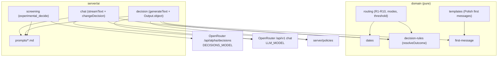
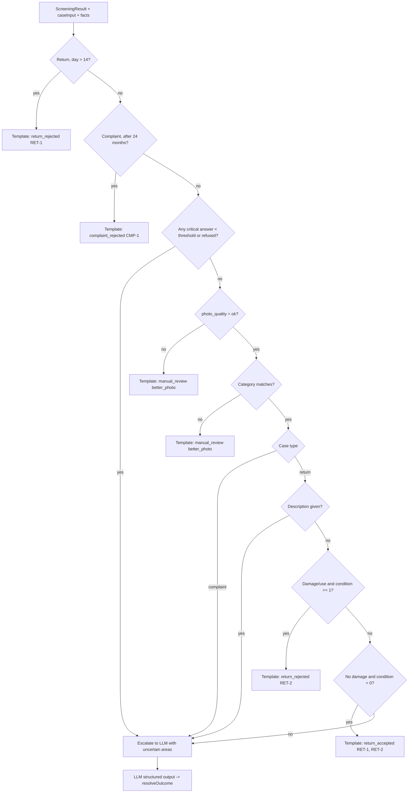
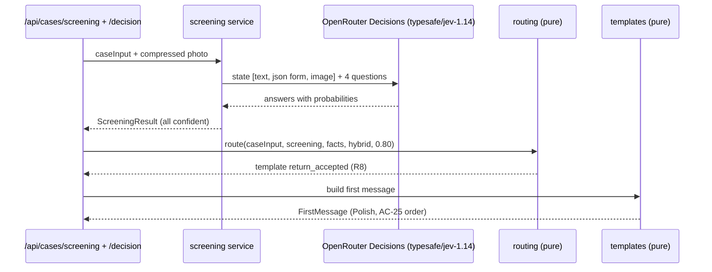
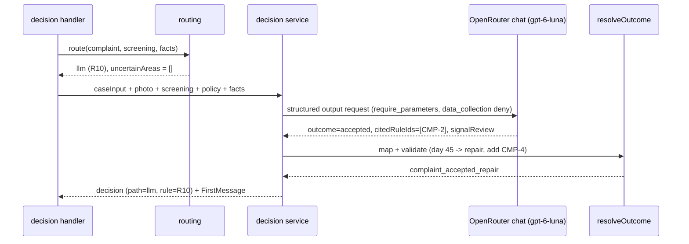
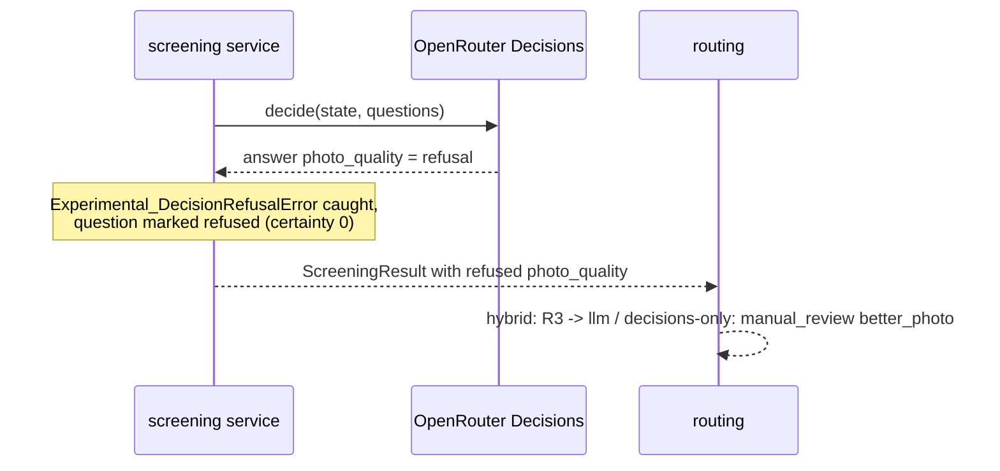

# ADR-003: AI Decision Engine — TypeSafe Jev Decisions Screening, Escalation to a Multimodal LLM, Chat Agent

**Date:** 2026-11-25 (revision 2026-11-26: screening model changed to `typesafe/jev-1.14`, see §6)
**Status:** Accepted
**Relates to:** [`000-main-architecture.md`](000-main-architecture.md), PRD §4, §11, AC-16, AC-18..AC-28, AC-32..AC-36; policies [`return-policy.md`](../policies/return-policy.md), [`complaint-policy.md`](../policies/complaint-policy.md)

---

## 1. Scope

Covers the decision pipeline behind the two processing stages and the chat:

1. **Screening** — one call to the OpenRouter Decisions API with the photo and form data, using the decision model `typesafe/jev-1.14` (TypeSafe Jev 1.14; calibrated probabilities, no prose).
2. **Routing** — deterministic code combines date rules, screening answers and a confidence threshold to decide whether the case can be decided **without** an LLM (template message) or must be **escalated** to the multimodal LLM `openai/gpt-6-luna`.
3. **Escalated decision** — one multimodal LLM call with photo, form, policy, deterministic facts and the screening signals, returning structured output.
4. **Chat** — streaming answers from the LLM with a validated `changeDecision` tool.
5. **Evaluation** — an offline script that compares the three decision modes on the example photos.

Not covered: HTTP contracts (ADR-002), UI (ADR-001), project setup (ADR-004).

---

## 2. Technology Documentation References

| Library / API | Context7 ID or official docs | Used for |
|---|---|---|
| AI SDK Core | `/vercel/ai` (versioned: `/vercel/ai/ai_7.0.0`), also `/websites/ai-sdk_dev` | `experimental_decide` (Decisions; `experimental_evaluate` is a deprecated alias), `generateText` + `Output.object`, `streamText`, `tool`, `stopWhen`, `abortSignal`, `maxRetries`, `Experimental_DecisionRefusalError` |
| OpenRouter AI SDK provider | `/openrouterteam/ai-sdk-provider` | `openrouter(modelId)` chat model, `openrouter.evaluationModel(modelId)`, provider `fetch` injection, `providerOptions.openrouter` (provider routing), `providerMetadata.openrouter` (per-answer `confidence`, `usage.cost`) |
| OpenRouter Decisions API | https://openrouter.ai/docs/guides/features/decisions, https://openrouter.ai/docs/guides/community/multimodal-decisions.md, https://openrouter.ai/docs/api/api-reference/alphadecisions/submit-a-decisions-request.md; model page https://openrouter.ai/typesafe/jev-1.14 | Request/response shape, image rules for OpenAI-served decision models, refusals, alpha status |
| OpenRouter structured outputs | https://openrouter.ai/docs/features/structured-outputs | `json_schema` support per endpoint, `require_parameters` |
| OpenRouter provider routing | https://openrouter.ai/docs/guides/routing/provider-selection | `require_parameters`, `data_collection` |
| Zod | `/colinhacks/zod` | LLM output schema, screening result schema |
| date-fns | https://date-fns.org/docs/Getting-Started | Calendar-day / calendar-month arithmetic |

### Research findings that drive this ADR (verified 2026-11-25)

| Finding | Source |
|---|---|
| Decisions models "do not emit conversational text, explanations, or free-form prose"; they return typed answers with calibrated probabilities | OpenRouter Decisions API reference |
| Endpoint `POST https://openrouter.ai/api/alpha/decisions`; "Alpha: the shape may change" | OpenRouter Decisions API reference |
| Question types: `noul` (AI SDK `boolean`, probability of true), `choice` (probabilities per option), `score` (ordered levels; continuous score 0..N−1 plus bucket probabilities); Jev 1.14 also supports `box` (not used here) | Decisions guide, API reference (read 2026-11-26) |
| A single question may be answered `{ "type": "refusal" }` while the others resolve; the docs require treating refusal, a missing key or an unexpected type as "not answered" (fail closed). `@openrouter/ai-sdk-provider@3.1.0` has no `refusal` answer type, so such a response fails the provider's response validation (`APICallError` with the raw `responseBody`) instead of raising `Experimental_DecisionRefusalError` | Decisions guide; provider `dist/index.js` (`OpenRouterDecisionsAnswerSchema`), verified 2026-11-26 |
| `state` is a string, JSON value or array; in an array plain strings are text items and an image item is `{ "type": "image_url", "image_url": { "url": "data:image/jpeg;base64,…" } }`. **Jev accepts only `image/png` and `image/jpeg` data URLs** (no remote URLs, no raw base64). Jev reads images anywhere in `state`, `instructions` and `criteria`. Each image: each side **256–1,568 px**, total **78,400–2,458,624 px** (inclusive; below → 400, above → 413); decoded file ≤ 16 MiB; request body ≤ 32 MiB; **EXIF orientation is not applied**; image input is an early TypeSafe feature whose format and limits may change between Jev releases | Multimodal decisions guide, read 2026-11-26 |
| **Correction (verified 2026-11-26 in the installed sources):** `ai@7.0.183` (`prepareDecisionState`) turns typed parts into language-model parts and `@openrouter/ai-sdk-provider@3.1.0` (`doEvaluate`) forwards `state` unchanged — the image arrives as `{ type: "file", mediaType, data }`, not as an `image_url` item. The app therefore normalizes the Decisions request body in the provider `fetch` (§3.2) | `node_modules/ai/dist/index.js`, `node_modules/@openrouter/ai-sdk-provider/dist/index.js` |
| Probabilities and scores are rounded to two decimals; per-answer `confidence` and `usage.cost` are exposed under `providerMetadata.openrouter` | `/openrouterteam/ai-sdk-provider` README |
| `experimental_decide` is experimental and "may change in patch releases" | `/vercel/ai` decisions docs |
| **Correction (R2, verified in the published packages on 2026-11-26):** `@openrouter/ai-sdk-provider@3.1.0` exposes the Decisions model as `openrouter.evaluationModel(id)` (legacy `doEvaluate`); there is no `decisionModel` method. `ai@7.0.183` resolves `decisionModel ?? evaluationModel` and adapts `doEvaluate`, so `experimental_decide` works with it. Routing options go in the nested object `providerOptions.openrouter.provider` with snake_case keys (`data_collection`, `require_parameters`) for both chat and decision calls. `ai/test` exports `Experimental_DecisionMockModelV4` | `.agent-logs/hsdc-poc-R2.report.md`; npm tarballs `@openrouter/ai-sdk-provider@3.1.0`, `ai@7.0.183` |
| `typesafe/jev-1.14` is listed among the popular Decisions models (text + images, all question types); provider "TypeSafe"; responses may name a dated snapshot in `model` (example `typesafe/jev-1.14-20261014`); `~typesafe/jev-latest` is an alias and is **not** used (pinned version); not available through EU in-region routing; price on the model page $0.042/M input tokens, $0 output; requests with images run in TypeSafe's long-context mode. Data-collection policy of the TypeSafe endpoint is not stated — verified by the first real call with `data_collection: deny` (TAC-003-07) | Model page and Decisions guide, read 2026-11-26 |
| `openai/gpt-6-luna` accepts `tools`, `tool_choice`, `response_format`, `stream`, `reasoning`; image input and `json_schema` support are not stated on its model page | OpenRouter model page — must be verified (TAC-003-07) |

---

## 3. Component Design

### 3.1 Deterministic layer (`domain/dates`, `domain/decision-rules`, `domain/routing`)

**Facts** (unchanged from the previous revision): `today` in `APP_TIME_ZONE` via an injected clock; `daysSincePurchase` in calendar days (purchase day = 0); `withinReturnWindow` = days ≤ 14 (RET-1); `withinWarranty` = today ≤ purchaseDate + 24 calendar months with month-end clamping (CMP-1); `withinDeadOnArrival` = days ≤ 30 (CMP-4).

**Labels** (verbatim AC-18/AC-19): `return_accepted` "Zwrot przyjęty", `return_rejected` "Zwrot odrzucony", `complaint_accepted_repair` "Reklamacja przyjęta – naprawa", `complaint_accepted_replacement_or_refund` "Reklamacja przyjęta – wymiana lub zwrot pieniędzy", `complaint_rejected` "Reklamacja odrzucona", `manual_review` "Wymaga weryfikacji przez konsultanta".

**Outcome mapping and validation:** any decision source (template, LLM, chat tool) produces an abstract outcome `accepted | rejected | manual_review`; `resolveOutcome` maps it to the case-type category, applies the CMP-4 remedy from `withinDeadOnArrival`, rejects acceptance outside the window/warranty, and requires non-empty `citedRuleIds` that exist in the loaded policy of the case type.

| Case type | Outcome | Category | Extra rule IDs added by code |
|---|---|---|---|
| return | `accepted` (only if `withinReturnWindow`) | `return_accepted` | — |
| return | `rejected` | `return_rejected` | — |
| complaint | `accepted` + `withinDeadOnArrival` (only if `withinWarranty`) | `complaint_accepted_replacement_or_refund` | CMP-4 if missing |
| complaint | `accepted` + not `withinDeadOnArrival` (only if `withinWarranty`) | `complaint_accepted_repair` | CMP-4 if missing |
| complaint | `rejected` | `complaint_rejected` | — |
| any | `manual_review` | `manual_review` | — |

`manualReviewKind` = `better_photo` when the source is a photo-gate template (R3 photo/R4/R5) or when the LLM returns `photoProblem = true`; otherwise `contact_support`. Whenever `manualReviewKind = better_photo` (any source), code guarantees at least two photo tips in `nextSteps` by appending the fixed tips from `domain/templates` (daylight, whole device visible, damage in focus) if fewer are present (AC-23).

### 3.2 Screening service (`server/ai/screening`)

One `experimental_decide` call with `openrouter.evaluationModel(DECISIONS_MODEL)` (`DECISIONS_MODEL=typesafe/jev-1.14`), `maxRetries: 1`, abort after 25 s, provider routing `data_collection: deny`.

**Wire format (Jev):** the provider `fetch` used for every OpenRouter call is wrapped by `server/llm` `withDecisionsWireFormat`, which rewrites only the `state` array of requests to `/decisions`: text part → plain string, JSON part → its value, JPEG/PNG file part → `{ "type": "image_url", "image_url": { "url": "data:image/jpeg;base64,…" } }`; any other part is rejected before sending. Responses are never modified.

**State** (ordered typed parts, sent as `[string, object, image_url item]`): (1) text — fixed English instruction "Customer-submitted photo of an electronic device for a return or warranty complaint"; (2) JSON — `{ caseType, formCategory, productName }` (the description is **not** sent; description-related checks are LLM-only, see §3.4); (3) file — the compressed JPEG (`image/jpeg`), which the browser has already rotated by its EXIF orientation and sized to Jev's limits (each side 256–1,568 px, ≥ 78,400 px total; ADR-001, ADR-002).

**Questions** — all four are **critical** (count toward the threshold):

| ID | Type | Area | Criteria |
|---|---|---|---|
| `photo_quality` | choice | Photo quality | `ok` (device clearly visible and sharp enough to judge surface condition), `blurry`, `too_dark`, `device_not_fully_visible`, `no_device` |
| `observed_category` | choice | Category match | `laptop`, `smartphone`, `tablet`, `monitor`, `tv`, `audio`, `console`, `other_electronics`, `no_device` (definitions in English mirroring AC-03) |
| `visible_damage_or_use` | boolean | Damage | true = any visible damage or sign of use per RET-2 list (scratches, scuffs, dents, cracks, chips, stains, dirt, residue, user stickers, missing parts, liquid marks, discoloration) |
| `condition` | score | Condition | 0 "like new, no visible marks", 1 "minor marks visible only on close inspection", 2 "clear signs of use", 3 "damaged" |

Question instructions and criteria are stored in `server/ai/prompts/screening.questions.md` (versioned) and loaded at build time.

**Certainty** per answer (computed by code from the returned probabilities, not from the provider's optional `confidence` field):
- choice → highest option probability;
- boolean → max(p, 1 − p);
- score → highest bucket probability.

An answer is **confident** when certainty ≥ `DECISIONS_CONFIDENCE_THRESHOLD` (default 0.80). The provider's per-answer `confidence` and `usage.cost` are stored in the result for logging and evaluation only.

**Failures:** a refused question is not an error for the customer — the screening result marks it `refused` (certainty 0), which forces escalation in `hybrid` and `llm-always` modes and manual review in `decisions-only` mode. With provider 3.1.0 a Jev refusal surfaces as a response-validation `APICallError`; `screenCase` parses its raw `responseBody` with its own schema of the documented response, keeps the answered questions and marks refused, missing or unexpected answers as `refused` (fail closed). `Experimental_DecisionRefusalError` (no partial answers) marks all four refused. Transport errors, timeouts and other invalid responses fail the stage (`llm_failed` / `llm_timeout`, ADR-002).

### 3.3 Routing (`domain/routing`, pure)

Input: `caseInput`, `ScreeningResult`, facts, `DECISION_MODE`, threshold. Output: a **route** — `template(category, ruleIds, manualReviewKind)` or `llm(uncertainAreas[])`. Rules are evaluated in order; the first match wins.

| # | Condition | `hybrid` (default) | `decisions-only` | `llm-always` |
|---|---|---|---|---|
| R1 | return and `!withinReturnWindow` | template `return_rejected` [RET-1] | same | llm (category fixed to `return_rejected`, LLM only explains) |
| R2 | complaint and `!withinWarranty` | template `complaint_rejected` [CMP-1] | same | llm (category fixed, explain only) |
| R3 | any critical answer not confident or refused | llm(uncertain areas) | template `manual_review`: `better_photo` [RET-3 / CMP-6] if `photo_quality` is the uncertain one, else `contact_support` [RET-4 / CMP-6] | llm |
| R4 | `photo_quality` ≠ `ok` | template `manual_review`, `better_photo` [RET-3 / CMP-6] | same | llm |
| R5 | `observed_category` = `no_device`, or form category ≠ `other` and observed category ≠ form category (form `other` accepts any observed category except `no_device`) | template `manual_review`, `better_photo` [RET-3 / CMP-6] | same | llm |
| R6 | return with a non-empty description | llm (RET-5 — description may reveal use; not covered by screening) | ignore description, continue to R7 | llm |
| R7 | return: `visible_damage_or_use` = true and `condition` ≥ 1 | template `return_rejected` [RET-2] | same | llm |
| R8 | return: `visible_damage_or_use` = false and `condition` = 0 | template `return_accepted` [RET-1, RET-2] | same | llm |
| R9 | return: screening answers contradict each other (damage true with condition 0, or damage false with condition ≥ 1) | llm | template `manual_review`, `contact_support` [RET-4] | llm |
| R10 | complaint (photo OK, category matches) | llm (cause of damage — CMP-2/CMP-3 — and description consistency — CMP-5 — are not screened) | `visible_damage_or_use` = true → `manual_review`, `contact_support` [CMP-6]; false → accepted (remedy by CMP-4) [CMP-6, CMP-4] | llm |

Consequence (accepted by the user on 2026-11-25): in `hybrid` mode, LLM-free decisions cover the date rules, the photo gate and returns without a description; **every complaint that passes the gates goes to the LLM**. `decisions-only` mode is an experiment mode; its complaint acceptance does not check CMP-5 contradictions and is a known limitation measured by the evaluation script.

### 3.4 Escalated decision service (`server/ai/decision`)

Called when the route is `llm`. One `AbortSignal` of 50 s covers the whole stage — the first call, transport retries and the corrective retry; when it fires the stage fails with `llm_timeout`. One `generateText` call with `Output.object({ schema: DecisionOutputWireSchema })` (validated afterwards with `DecisionOutputSchema`), model `openrouter(LLM_MODEL)`, **no `temperature`** (revision 2026-11-26: with `require_parameters: true` a `temperature` parameter left no `openai/gpt-6-luna` endpoint — real HTTP 404 "Filter by Parameters"; `json_schema` and image input are supported), `maxRetries: 1`, abort after 50 s, provider routing `require_parameters: true` (only providers supporting structured outputs) and `data_collection: deny`.

Message content: system prompt `decision.<return|complaint>.md` (+ shared `_guardrails.md`) with the full policy text; user content with (1) deterministic facts block, (2) form data block (description quoted as customer data), (3) screening signals block — every answer with its value and certainty, the list of uncertain areas to verify first, and an instruction that signals are hints from an automated pre-check that must be verified against the photo, (4) the image as a file part (`image/jpeg`).

If the route came from R1/R2 in `llm-always` mode, the prompt states the fixed category and the model only writes justification, findings and next steps; its `outcome` is ignored.

The model returns the abstract outcome, evidence and Polish texts (§4). Code maps and validates through `resolveOutcome`; invalid rule IDs or missing evidence trigger one corrective retry, then `llm_failed`. Disagreements between the LLM and confident screening answers are kept in `signalReview` and logged; the LLM's outcome wins because it sees the photo, the description and the policy.

### 3.5 Template decisions (`domain/templates`)

When the route is `template`, no LLM is called. `buildTemplateFirstMessage` composes the `FirstMessage` from Polish templates per category and rule:
- greeting — fixed neutral sentence;
- justification — per rule (R1 includes "N dni od zakupu" and the 14-day limit; R2 cites the 24-month warranty; R4 names the photo problem from `photo_quality`; R5 names the observed vs selected category; R7/R8 describe the screening result);
- "Co widzimy na zdjęciu" — sentences generated from screening answers (observed category, damage/use, condition level), without percentages;
- "Kolejne kroki" — Polish versions of RET-6 / CMP-7 (accepted); for rejections: R1 → "Jeśli sprzęt jest wadliwy, możesz złożyć reklamację (gwarancja 24 miesiące od zakupu)." + contact `support@example.com` (RET-1), R2 → "Płatna naprawa jest dostępna po kontakcie z obsługą: support@example.com." (CMP-1), R7 → "Jeśli sprzęt ma wadę, możesz złożyć reklamację zamiast zwrotu." + "W razie pytań napisz na support@example.com." (RET-2 offers no alternative of its own; these steps only point to options that exist in the policies); RET-7 / CMP-8 with at least two photo tips (manual review, AC-23);
- notice — AC-26 constant.

Templates copy policy facts (addresses, e-mail, deadlines) into Polish text. A unit test asserts that every address, e-mail and number of days used in templates appears in the corresponding policy file, so a policy change that breaks a template fails the build.

### 3.6 Chat service (`server/ai/chat`)

`streamText` with `openrouter(LLM_MODEL)`, no `temperature` (unsupported by the model's endpoints, see §3.4), `stopWhen` step count 3, abort after 60 s or on client disconnect, `data_collection: deny`. System prompt `chat.<return|complaint>.md` + guardrails + policy + facts (recomputed per request) + case data + screening signals (values and certainty) + LLM findings (if the case was escalated) + current decision + decision path. The canonical text of the first message is inserted as the first assistant message. The chat never receives the image (ADR-002).

Tool `changeDecision` (unchanged): input `{ outcome, citedRuleIds, reason }`; execution validates with `resolveOutcome` using recomputed facts; accepted changes emit a `data-decision` part and return `{ accepted: true, category, label }`; refused proposals return `{ accepted: false, why }`. The model never writes "Zmiana decyzji" itself (ADR-001 renders the header).

Guardrails: case-only scope with the verbatim off-topic sentence "Mogę pomóc tylko w sprawie tego zgłoszenia — zwrotu lub reklamacji i związanych z nimi procedur." (AC-35, constant in `domain/templates`, quoted in the chat prompts), no photo/file intake (AC-36), no personal data requests, no invented rules or compensation, no change under pressure (AC-34), no claim of finality, neutral gender-free Polish.

### 3.7 Evaluation script (`scripts/eval-decisions`)

`npm run eval:decisions` (manual, not in CI, requires `OPENROUTER_API_KEY`) runs every photo in `assets/example-images/` against a fixed set of synthetic forms (return within window without description, return with description, complaint within 30 days, complaint after 30 days, category deliberately mismatched) in all three modes. For each run it records: mode, route rule (R1–R10), screening answers with certainties, refusals, final category, cited rule IDs, escalation areas, LLM/screening disagreements, latency per stage and cost from `providerMetadata.openrouter.usage.cost` (decisions) and usage (LLM). Output: `app/eval-reports/<timestamp>.json` and `.md` (gitignored). Per `assets/example-images/README.md`, the script never tells any model what a photo shows and asserts nothing about expected photo content; it reports, and humans review. Threshold changes are made only after reviewing a report.

### 3.8 Prompts and questions (`server/ai/prompts/`)

Files: `screening.questions.md`, `decision.return.md`, `decision.complaint.md`, `chat.return.md`, `chat.complaint.md`, `_guardrails.md`. Each starts with `prompt-version: YYYY-MM-DD.n`; the version is logged and recorded in capture metadata. Customer text is always inside delimited data blocks marked as customer data. Prompts are in English and demand Polish output; fixed Polish strings come from code constants.

---

## 4. Data Structures

### ScreeningResult
- `answers`: per question ID — `{ value, probabilities, certainty, confident, refused, providerConfidence? }`
- `uncertainAreas`: list of question IDs with `confident = false`
- `model`, `promptVersion`, `costCredits?`, `latencyMs`

### Route
- `{ kind: 'template', rule: R1..R10, category, citedRuleIds, manualReviewKind }` or `{ kind: 'llm', rule, uncertainAreas, fixedCategory? }`

### DecisionOutputSchema (LLM structured output)
- `outcome` `accepted | rejected | manual_review`; `photoProblem` boolean
- `citedRuleIds` 1–5, pattern `^(RET|CMP)-\d+$`
- `evidence` 1–5 of `{ source: photo | date | description | screening, text ≤ 200 }`
- `signalReview` per screening question: `agree | disagree | not_assessable`, with a short note ≤ 160
- `greetingPl` ≤ 200; `justificationPl` 40–1200; `photoFindingsPl` 20–600; `nextStepsPl` 1–6 items ≤ 240; `uncertaintyPl` ≤ 400 or null (required for `manual_review`)

### DecisionResult (extended)
- Previous fields (`category`, `label`, `citedRuleIds`, `justification`, `photoFindingsSummary`, `nextSteps`, `manualReviewKind`) plus `decisionPath`: `template` | `llm`, `routeRule`: R1..R10, `mode`: `hybrid` | `decisions-only` | `llm-always`.

### ChangeDecisionInput / Result
- Input (tool parameters, zod): `outcome` `accepted | rejected | manual_review`; `citedRuleIds` 1–5 strings matching `^(RET|CMP)-\d+$`; `reason` string 1–400.
- Result returned to the model: `{ accepted: true, category, label }` or `{ accepted: false, why }` with `why` ∈ `outside_return_window`, `outside_warranty`, `not_allowed_for_case_type`, `unknown_rule_id`, `no_change`.

### LlmFindings (escalated cases only)
- `photoFindingsPl` (from `DecisionOutputSchema`), `evidence[]`, `signalReview` (per screening question). Returned by the decision endpoint as `llmFindings` and sent back by the client in `ChatRequest.caseContext.llmFindings`; absent for template routes.

### DecisionHistoryEntry (client and chat context)
- `{ category, label, citedRuleIds, source: 'initial' | 'chat', manualReviewKind: 'better_photo' | 'contact_support' | null }`. The initial entry is built from `DecisionResult`; chat entries from the `data-decision` part, which therefore also carries `manualReviewKind`. The client keeps at most 20 entries; when the cap is reached the oldest **chat** entry is dropped (the initial entry is always kept).

---

## 5. Interface Contracts

| Function | Input | Output | Errors |
|---|---|---|---|
| `screenCase(caseInput, caseImage, { decisionModel, signal })` | validated | `ScreeningResult` | `LlmFailedError`, `LlmTimeoutError` (refusals are folded into the result) |
| `routeCase(caseInput, screening, facts, mode, threshold)` (pure) | — | `Route` | — |
| `decideWithTemplate(route, caseInput, screening, facts)` (pure) | — | `{ decision, firstMessage }` | — |
| `decideWithLlm(route, caseInput, caseImage, screening, { model, policies, clock, signal })` | validated | `{ decision, firstMessage }` | `LlmFailedError`, `LlmTimeoutError` |
| `streamChat(caseContext, messages, { model, policies, clock, signal })` | validated | UI message stream | masked stream error |
| `resolveOutcome(caseType, outcome, facts, citedRuleIds, policyRuleIds)` (pure) | — | `DecisionResult` or validation error | — |

Models, policies and clock are injected; tests never call the network or depend on the real date.

---

## 6. Technical Decisions

### Decisions-model screening before the LLM (TypeSafe Jev 1.14)
**Status:** Accepted
**Date:** 2026-11-25
**Context:** The user wants a cheap first-pass classifier that judges photo quality, category, damage and condition with measurable certainty, passes signals to the LLM and allows skipping the LLM when certainty is high.
**Decision:** Every case is screened by `typesafe/jev-1.14` (exact version, not the `~typesafe/jev-latest` alias) through `experimental_decide` and `openrouter.evaluationModel`, with the Decisions request body normalized to the documented wire format in the provider `fetch`. Its calibrated probabilities feed a deterministic router; the LLM receives the signals when the case is escalated.
**Revision 2026-11-26:** the reviewer replaced `openai/gpt-6-luna-decisions` (model page unavailable during research, images only as top-level state items) with `typesafe/jev-1.14`. Consequences: JPEG/PNG only (WEBP converted in the browser as before), stricter image size window (256–1,568 px per side, ≥ 78,400 px), no EXIF handling by the API, per-question refusals, a request-format adapter for provider 3.1.0. The questions, certainty rule, threshold and routing are unchanged.
**Rejected alternatives:**
- LLM-only analysis (previous revision): no calibrated certainty, every case pays for an LLM call.
- Raw HTTP calls to `/api/alpha/decisions`: duplicates what the provider already maps (typed parts, refusals, rounding, metadata).
**Consequences:**
- (+) Measurable certainty per area; LLM-free decisions for clear returns and gate failures.
- (+) One provider, one API key, same error and retry model as the LLM.
- (-) Two experimental surfaces (`experimental_decide`, Decisions API alpha) — mitigated by pinning exact versions and a contract test against captured responses.
- (-) The installed provider does not emit the Decisions wire format or parse refusals for this model; mitigated by the `fetch` request adapter and raw-body refusal parsing, both covered by tests and to be confirmed by real captures (TAC-003-07).
- (-) TypeSafe marks image input as early and changeable between Jev releases; the version is pinned and captures are re-recorded on any model change.
**Review trigger:** Decisions API leaves alpha, changes its shape, or the model becomes unavailable.

### Certainty = top probability, threshold 0.80, whole-case escalation
**Status:** Accepted
**Date:** 2026-11-25
**Context:** The provider's `confidence` field is optional and its computation is not documented; probabilities are always returned.
**Decision:** Certainty is computed from probabilities (§3.2). Any critical answer below the threshold escalates the whole case with the list of uncertain areas. The threshold is an env var (default 0.80).
**Rejected alternatives:**
- Provider `confidence`: undocumented and optional.
- Partial escalation (LLM answers only uncertain questions): merge logic and inconsistent justifications.
**Consequences:**
- (+) Simple, testable rule; tunable without code changes.
- (-) One uncertain area costs a full LLM call.
**Review trigger:** The evaluation report shows > 50 % of return cases escalated or template decisions overturned by humans.

### Three decision modes behind `DECISION_MODE`
**Status:** Accepted
**Date:** 2026-11-25
**Context:** The user wants to test whether the decision model alone is sufficient.
**Decision:** `hybrid` (default), `decisions-only`, `llm-always`, selected per process by env var; every `DecisionResult` records the mode, path and rule.
**Rejected alternatives:**
- Per-request mode from the client: lets customers choose the decision strategy.
**Consequences:**
- (+) Direct comparison in the evaluation script and in Manual QA.
- (-) Three code paths to test; mitigated by the pure routing table tested exhaustively.
**Review trigger:** One mode is chosen for good; remove the others.

### Template first messages for LLM-free routes
**Status:** Accepted
**Date:** 2026-11-25
**Context:** Skipping the LLM means no model writes the Polish justification.
**Decision:** Polish templates in code, guarded by a test that checks policy facts used in templates against the policy files.
**Rejected alternatives:**
- Call the LLM only to write text: removes most of the saving.
**Consequences:**
- (+) Deterministic, instant, AC-25/AC-26 compliant first messages.
- (-) Replacing the policies requires updating templates (conflicts with PRD §8 "replacing policies must not require changing product behavior" for template routes; accepted for the PoC and caught by the guard test).
**Review trigger:** Real company policies replace the fictional ones.

### Privacy routing for customer photos
**Status:** Accepted
**Date:** 2026-11-25
**Context:** Photos and descriptions go to an external AI service (PRD §8).
**Decision:** All OpenRouter calls set provider routing `data_collection: deny`; the Decisions `user` and `session_id` fields are not sent.
**Rejected alternatives:**
- Default routing: providers that may store or train on data could be selected.
**Consequences:**
- (+) Fewer data-retention risks.
- (-) Fewer eligible providers; a request may fail if none qualifies (surfaced as `llm_failed`).
**Review trigger:** A provider-specific data agreement is signed.

### Open questions (not blocking)
- Add `damage_cause` and `description_consistent` screening questions so complaints can skip the LLM — decide after the first evaluation report.
- Whether `imageDetail`/`detail: high` changes screening accuracy — compare in the evaluation script.

---

## 7. Diagrams

### Component diagram

### Routing flow (hybrid mode)

### Sequence — return decided without the LLM

### Sequence — complaint escalated to the LLM

### Sequence — screening refusal

---

## 8. Testing Strategy

LLM and Decisions doubles are **HTTP-level replays**: both OpenRouter models are created with an injected `fetch` that returns captured responses verbatim (status, headers, body). Captures come from `npm run capture:llm` against the real APIs with synthetic forms and `assets/example-images/`, saved under `tests/fixtures/llm-captures/` with metadata (date, endpoint, model ID, prompt version, request summary without secrets). This exercises the real provider mapping (typed parts, refusals, rounding) and satisfies the AGENTS.md capture rule.

### Test scenarios for this area

| Scenario | Type | Input | Expected output | Edge cases |
|---|---|---|---|---|
| Certainty computation | Unit | choice/boolean/score probabilities | top prob; max(p,1−p); top bucket | 0.80 exactly is confident; rounding to 2 decimals |
| Routing table | Unit | every R1–R10 condition × 3 modes | Table §3.3 exactly | First-match order (R1 beats R3) |
| Category match | Unit | form `other` vs each observed; form `laptop` vs `laptop`/`tablet`/`no_device` | Match rules of R5 | `other_electronics` vs form `other` |
| Contradictory screening | Unit | damage true + condition 0 | hybrid → llm; decisions-only → manual review RET-4 | — |
| Templates | Unit | each template route | AC-25 order, AC-26 notice, Polish, day count for R1, ≥ 2 tips for better_photo | Singular/plural "dzień/dni" |
| Template ↔ policy guard | Unit | templates + policy files | Every address, e-mail, day count in templates exists in the policy | Policy edited → test fails |
| Outcome mapping & validation | Unit | all case types × outcomes × date facts; invalid rule IDs | Exactly the mapping table in §3.1; acceptance outside window/warranty rejected; unknown or cross-type rule IDs rejected | `photoProblem` → `better_photo` + ≥ 2 tips |
| Screening service | Integration (replay) | captured decisions responses | Parsed `ScreeningResult` with certainties and cost | Real captured errors (401/404); timeout = delayed real capture; refusal only from a real capture, else reported gap — never hand-written responses or `ai/test` mock models |
| Screening request shape | Integration | intercepted request in injected fetch | `state` array with image part as data URL at top level; no description; no `user`/`session_id`; `data_collection: deny` | — |
| Escalated decision | Integration (replay) | captured chat-completions responses | Valid `DecisionResult` with `decisionPath = llm` | Corrective retry; disagreement logged |
| LLM request shape | Integration | intercepted request | image part present, screening block present, `require_parameters: true` | Fixed-category explain-only prompt in llm-always |
| Chat service | Integration (replay) | question / new fact / off-topic | Text stream; `data-decision` only for accepted tool call | Tool refused |
| Evaluation script | Unit (report builder) + manual run | fake runs | Report JSON/MD with all fields | Missing cost metadata |

### Live E2E scenarios (`@live`, real models)

Assertions are property-based and never assume photo content (per `assets/example-images/README.md`).

| # | Case | Expected (stable properties) |
|---|---|---|
| L1 | Return, today−20, `phone-1.jpg` | "Zwrot odrzucony", contains "20" and "14", RET-1, `decisionPath = template` (R1) |
| L2 | Complaint, today−3 years, `laptop-2.webp` | "Reklamacja odrzucona", CMP-1, `decisionPath = template` (R2) |
| L3 | Return, today−3, no description, `phone-2.jpeg` | Label ∈ return labels; ≥ 1 RET-* cited; AC-25 sections; AC-26 notice; path is template or llm and matches the route rule |
| L4 | Complaint, today−10, `laptop-1.png`, description of screen lines without a fall | Label ∈ complaint labels; `decisionPath` matches `routeRule` (R4/R5 → template; R3/R10 → llm); if accepted then "wymiana lub zwrot pieniędzy" |
| L5 | After L3: "jaką datę zakupu podałem?" | Answer contains the purchase date (AC-32) |
| L6 | After L1: pressure + off-topic | Label unchanged; off-topic declined (AC-34, AC-35) |

### Technical acceptance criteria

- TAC-003-01: `domain/routing`, `domain/decision-rules` and `domain/dates` have 100 % branch coverage.
- TAC-003-02: No `DecisionResult` is produced without passing through `resolveOutcome` or a template builder that uses `resolveOutcome`.
- TAC-003-03: Every model call sets an abort signal, `maxRetries ≤ 1` and `data_collection: deny`; every LLM structured-output call sets `require_parameters: true`.
- TAC-003-04: Every prompt/question file has a `prompt-version` line referenced by current capture metadata.
- TAC-003-05: The screening request never contains the customer description, `user` or `session_id`.
- TAC-003-06: `npm run eval:decisions` produces a report covering all photos × synthetic forms × 3 modes with route rule, certainties, final category, latency and cost per run.
- TAC-003-07: Before live work starts, the agent confirms via `GET https://openrouter.ai/api/v1/models?output_modalities=decisions&input_modalities=image` that `typesafe/jev-1.14` exists and accepts images, and the first real screening capture confirms the normalized request is accepted with `data_collection: deny`, and via the model list that `LLM_MODEL` supports image input, `structured_outputs` and `tools`; results are recorded in `tests/fixtures/llm-captures/README.md`. If either check fails, implementation stops and the user chooses another model.
