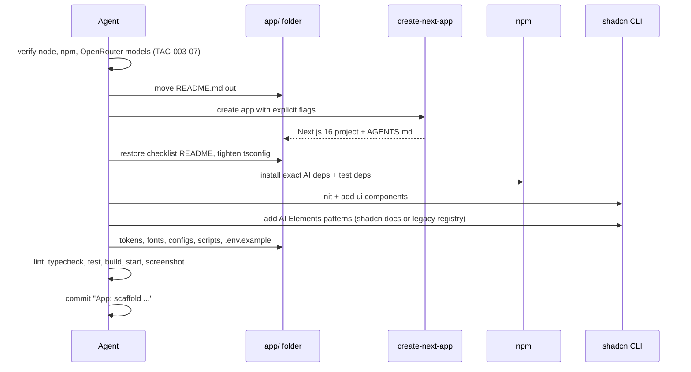
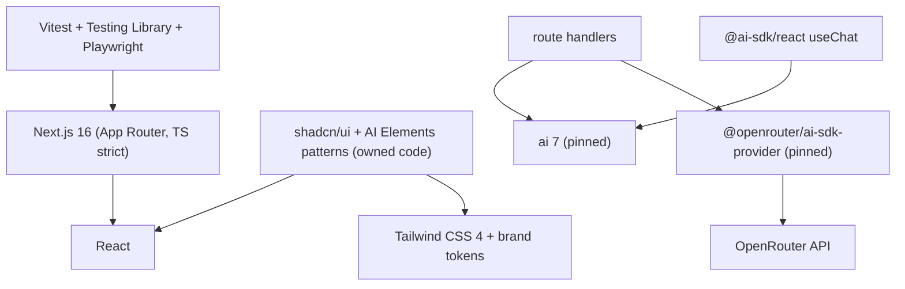

# ADR-004: Project Initialization — From an Empty `app/` to a Verified Scaffold

**Date:** 2026-11-25
**Status:** Accepted
**Relates to:** [`000-main-architecture.md`](000-main-architecture.md), [`001-frontend.md`](001-frontend.md)

---

## 1. Scope

How the implementing agent creates the application in the empty `app/` folder: tool choice, exact order of steps, dependencies and pinning, TypeScript strictness, UI libraries, scripts, environment files and the verification that ends the scaffolding task. It contains no product features; feature work starts only after this scaffold is verified and committed.

Not covered: feature implementation (ADR-001..003).

---

## 2. Technology Documentation References

| Tool / library | Context7 ID or official docs | Used for |
|---|---|---|
| create-next-app | `/vercel/next.js/v16.4.5` (docs `01-app/03-api-reference/06-cli/create-next-app`) | Non-interactive project creation |
| shadcn CLI | `/shadcn-ui/ui` (versioned: `/shadcn-ui/ui/shadcn_4.21.0`) | `init`, adding components |
| AI Elements (shadcn) | https://ui.shadcn.com/docs/ai-elements ; legacy `/vercel/ai-elements` | Chat, Message, Prompt Input patterns |
| AI SDK | `/vercel/ai` | Package set (`ai`, `@ai-sdk/react`); README requires Node.js 22+ |
| OpenRouter provider | `/openrouterteam/ai-sdk-provider` | Provider package, `ai` ≥ 7.0.133 for typed Decisions state |
| Vitest | `/vitest-dev/vitest` | Test runner config |
| Playwright | `/microsoft/playwright` | E2E config, browsers |

### Options evaluated for starting the project

| Option | What it is (verified 2026-11-25) | Fit for this PRD |
|---|---|---|
| `create-next-app` + shadcn + AI Elements | Official Next.js CLI; defaults: TypeScript, Tailwind, ESLint, App Router, Turbopack, `@/*`, `AGENTS.md`; Cache Components on by default for App Router | **Chosen.** Clean start with only what the PRD needs; each step verifiable |
| shadcn `chatbot-template` | Next.js app with AI SDK and shadcn/ui, recommended on the AI Elements page | Faster chat demo, but brings chat-app structure (history, model selector, generic routes) the PRD does not need and that must be removed |
| Chat SDK (chat-sdk.dev) | "A TypeScript library for building chat bots that run on multiple platforms" (Slack, Teams, Google Chat, Discord, Telegram, WhatsApp); state via Redis | **Not a fit:** no browser chat UI and not a Next.js app template |
| assistant-ui `init` | `npx assistant-ui@latest init` scaffolds a Thread UI on a runtime wrapping `useChat` (ai@7) | Viable UI kit, rejected in ADR-001 (extra runtime layer; custom data parts undocumented) |

---

## 3. Component Design — Initialization Procedure

Each numbered step ends with its check; the agent stops and reports if a check fails.

| # | Step | Check |
|---|---|---|
| 0 | Confirm tools: `node -v` ≥ 22 (VM has 24.x), `npm -v`; run TAC-003-07 model verification | Versions printed; both models verified or user decision recorded |
| 1 | Move `app/README.md` (course checklist) to a temporary location outside `app/`; `create-next-app` refuses non-empty folders with conflicting files | `app/` is empty |
| 2 | From the repository root: `npx create-next-app@16.4 app --ts --tailwind --eslint --app --src-dir --import-alias "@/*" --use-npm --disable-git --agents-md --yes` (`--disable-git`: the course repo already exists; `--agents-md`: generates `app/AGENTS.md` with up-to-date Next.js guidance) | `app/package.json`, `app/src/app/page.tsx`, `app/AGENTS.md` exist; no nested `.git` |
| 3 | Restore the course checklist as `app/README.md` (replacing the generated one) and add a "Commands" section | README contains checklist + commands |
| 4 | TypeScript: confirm `"strict": true` in `app/tsconfig.json`; add `noUncheckedIndexedAccess`, `noImplicitOverride`, `noFallthroughCasesInSwitch` | `npx tsc --noEmit` passes |
| 5 | Runtime deps, **exact versions** (`npm install --save-exact`): `ai` (7.x, ≥ 7.0.133), `@ai-sdk/react` (4.x), `@openrouter/ai-sdk-provider` (3.x), `zod` (4.x), `react-hook-form`, `@hookform/resolvers`, `date-fns`, `server-only`, `streamdown` | `package.json` has no `^`/`~` for these |
| 6 | Dev deps: `vitest`, `@vitejs/plugin-react`, `jsdom`, `@testing-library/react`, `@testing-library/user-event`, `@testing-library/jest-dom`, `@playwright/test`, `@axe-core/playwright`, `prettier`, `eslint-config-prettier`, `tsx` (scripts), `@vitest/coverage-v8` (same version as `vitest`) | Installed |
| 7 | `npx shadcn@latest init` (detects Tailwind v4); then add: button, input, textarea, label, select, radio-group, calendar, popover, alert, alert-dialog, badge, card, collapsible, dialog, spinner | `app/components.json`; components in `src/components/ui/` |
| 8 | AI Elements (verified in research R1): `npx shadcn@latest add message-scroller message bubble input-group` (Radix variant, same as step 7; no `attachment`). Components land in `src/components/ui/`; the chat composition is our own code in `src/features/chat/` (ADR-001 §3). Record the source in `app/README.md` | `message-scroller.tsx`, `message.tsx`, `bubble.tsx`, `input-group.tsx` under `src/components/ui/`; typecheck passes |
| 9 | Design tokens: map `assets/design-tokens.json` to Tailwind `@theme` variables in `src/app/globals.css`; copy DM Sans woff2 files to `src/fonts/` and load with `next/font/local`; copy logo and favicon to `public/` | Page renders with DM Sans and brand colors |
| 10 | Config files: `vitest.config.ts` (jsdom for components, node for `domain`/`server`), `playwright.config.ts` (`webServer` runs `npm run build && npm run start`, projects chromium/firefox/webkit, `@live` tag excluded by default), `.prettierrc`, `.editorconfig`. `server-only` throws outside the `react-server` export condition: Vitest gets `resolve.conditions` including `react-server` (or an alias of `server-only` to an empty module) and `tsx` scripts run with `node --conditions=react-server` — verify the exact options via Context7 before configuring | `npm run test` runs zero tests successfully; a server module importing `server-only` loads in Vitest and in `npm run capture:llm --help`; `npx playwright test --list` works |
| 11 | Scripts (see §5) and `app/.env.example` (see ADR-000 §7); `.env.local` created locally, gitignored | `npm run lint && npm run typecheck` pass |
| 12 | `npx playwright install chromium firefox webkit` | Browsers installed |
| 13 | Extend `app/AGENTS.md` with stack-specific rules (commands, folder boundaries, test layers, "query Context7 `/vercel/ai` before using AI SDK APIs") using the `/write-agents-md` skill; keep root `AGENTS.md` generic | Nested AGENTS.md ≤ 150 lines |
| 14 | Verification: `npm run lint`, `npm run typecheck`, `npm run test`, `npm run build`, `npm run start` + Playwright CLI screenshot of `/` | All pass; screenshot taken |
| 15 | Commit: `App: scaffold Next.js app with AI SDK and shadcn` (named paths only) | Clean `git status` except intended files |

---

## 4. Data Structures

Not applicable (no runtime data). Resulting folder layout is defined in ADR-000 §3.

---

## 5. Interface Contracts — npm scripts

| Script | Command purpose |
|---|---|
| `dev` | Next.js dev server (Turbopack) |
| `build` / `start` | Production build and server on port 3000 |
| `lint` | ESLint, zero warnings allowed |
| `typecheck` | `tsc --noEmit` |
| `test` | Vitest run (unit, component, integration; no network) |
| `test:watch` | Vitest watch |
| `test:coverage` | Vitest with `@vitest/coverage-v8` and the per-file thresholds from ADR-000 TAC-03 |
| `test:e2e` | Playwright excluding `@live` |
| `test:e2e:live` | Playwright `@live` only (real OpenRouter, costs money) |
| `capture:llm` | Records real OpenRouter responses into `tests/fixtures/llm-captures/` |
| `eval:decisions` | Runs the decision-mode evaluation report (ADR-003 §3.7) |
| `format` | Prettier write |

---

## 6. Technical Decisions

### `create-next-app` with explicit flags, not a chat template
**Status:** Accepted
**Date:** 2026-11-25
**Context:** The project starts from an empty `app/` and the agent initializes it; the PRD's flow (form → processing → chat) differs from generic chat apps.
**Decision:** `create-next-app@16.4` with explicit flags, then shadcn and AI Elements patterns added on top.
**Rejected alternatives:**
- shadcn chatbot-template: removal work and leftover chat-app assumptions.
- Chat SDK: multi-platform bot library without a web UI.
- Manual setup: the boilerplate already provides tsconfig, ESLint and Tailwind correctly (course rule: do not hand-create boilerplate config).
**Consequences:**
- (+) Minimal, reviewable scaffold; generated `AGENTS.md` keeps agents on current Next.js APIs.
- (-) Chat UI has to be assembled from patterns (planned in ADR-001).
**Review trigger:** A future project needs multi-chat history and persistence out of the box.

### Exact version pinning for AI packages
**Status:** Accepted
**Date:** 2026-11-25
**Context:** `experimental_decide` "may change in patch releases" and the Decisions API is alpha.
**Decision:** `ai`, `@ai-sdk/react` and `@openrouter/ai-sdk-provider` are installed with exact versions; upgrades are deliberate, followed by `npm run capture:llm` and the full test suite.
**Rejected alternatives:**
- Caret ranges: a patch release could silently break screening.
**Consequences:**
- (+) Reproducible behavior across VMs.
- (-) Manual upgrades.
**Review trigger:** `experimental_decide` becomes stable.

### Keep Cache Components default, avoid segment `dynamic`
**Status:** Accepted
**Date:** 2026-11-25
**Context:** `create-next-app` 16.4 enables Cache Components by default for App Router; the app's page is a client component and all APIs are POST route handlers.
**Decision:** Keep the default; never use the route segment `dynamic` option; POST handlers are uncached by nature. If the build reports a Cache Components conflict, the agent reports it instead of disabling features silently.
**Rejected alternatives:**
- `--no-cache-components`: diverges from current defaults without a demonstrated problem.
**Consequences:**
- (+) Aligns with current Next.js docs and generated AGENTS.md.
- (-) Some older examples (with `dynamic = 'force-dynamic'`) must not be copied.
**Review trigger:** Build or runtime error attributable to Cache Components.

---

## 7. Diagrams

### Initialization sequence

### Resulting dependency layers

---

## 8. Testing Strategy

### Test scenarios for this area

| Scenario | Type | Input | Expected output | Edge cases |
|---|---|---|---|---|
| Scaffold builds | Command | `npm run build` | Exit 0, no warnings | — |
| Strict TypeScript | Command | `npm run typecheck` with an intentional `any`-free codebase | Exit 0 | `noUncheckedIndexedAccess` errors fixed, not suppressed |
| Test runners wired | Command | `npm run test`, `npx playwright test --list` | Runners start; zero failures | No tests yet → Vitest `passWithNoTests` only during scaffold commit |
| App starts | Manual QA | `npm run start`, open `/` with Playwright CLI | Page loads, header with logo, DM Sans, no console errors | Mobile 360 px |
| Pinned versions | Command | inspect `package.json` | Exact versions for AI packages | — |

### Technical acceptance criteria

- TAC-004-01: `app/` contains a Next.js 16 App Router project with `src/`, `@/*` alias, ESLint, Tailwind 4 and `"strict": true` plus the three extra compiler flags.
- TAC-004-02: `ai`, `@ai-sdk/react`, `@openrouter/ai-sdk-provider` are pinned to exact versions; `ai` ≥ 7.0.133.
- TAC-004-03: `npm run lint`, `typecheck`, `test`, `build` pass and `npm run start` serves `/` with no console errors.
- TAC-004-04: No nested `.git` directory exists in `app/`; `.env.local` is gitignored; `app/.env.example` lists every variable from ADR-000 §7.
- TAC-004-05: `app/README.md` documents the AI Elements source used (shadcn docs or legacy registry) and all npm scripts.
