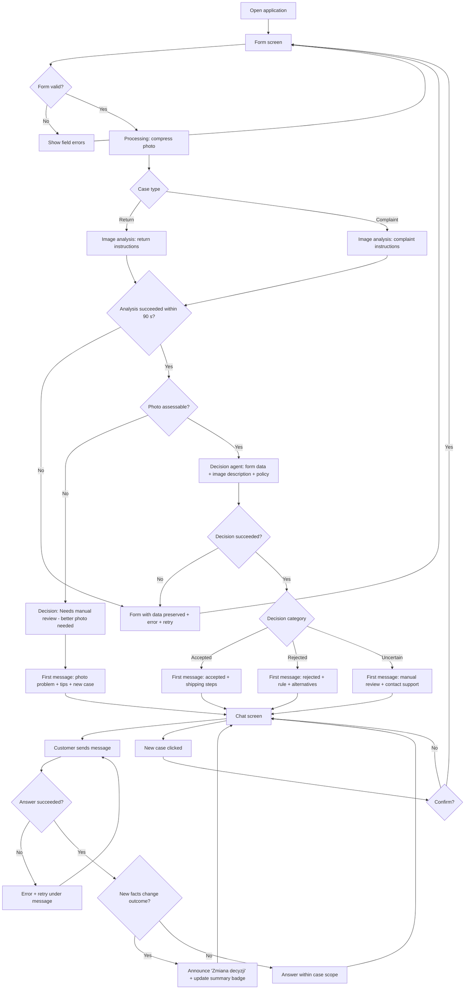

# PRD — Hardware Service Decision Copilot

---

## 1. Executive Summary

Hardware Service Decision Copilot is a **proof of concept (PoC)** of a self-service web application in which a customer files a complaint (warranty claim) or a return for a piece of electronic equipment by filling in a form and uploading one photo. The system analyzes the photo with a multimodal AI model and an AI decision agent then applies the company's complaint or return policy, giving the customer an immediate decision with a justification and next steps. The customer can then continue in a chat with the agent to ask questions or add information. The goal is to reduce manual work for the customer support and hardware service teams on clear-cut cases and to give customers a fast, consistent first answer.

---

## 2. Problem Statement

- Every complaint and return is reviewed manually by the support or service team, including cases where the photo alone makes the outcome obvious (e.g. an unused product returned on day 3, or a screen cracked by an impact).
- Customers wait for a first answer and often do not know which documents, packaging or shipping steps are needed, which causes follow-up messages to support.
- Decisions are applied inconsistently because staff interpret the complaint and return policies differently.
- Today the customer sends an e-mail or calls support, attaches photos in an ad-hoc way, and waits for a staff member to read the policy, assess the photo and answer.

---

## 3. Users / Personas

All users are **customers** using the application without logging in. The support and service teams are stakeholders: they receive the physical product afterwards and handle "Needs manual review" cases outside this application.

### Persona 1 — Anna, return of an unused product
Bought a tablet online 5 days ago, changed her mind, the tablet is unused. Wants to know quickly whether she can return it and how to send it back. Expects a clear yes/no and exact shipping steps.

### Persona 2 — Marek, complaint about a faulty laptop
His 14-month-old laptop has lines on the screen. Not sure whether the warranty covers it. Expects an honest assessment of whether it is a covered defect, what remedy he will get, and what to do next. Will ask follow-up questions in the chat (e.g. "do I need to send the charger?").

### Persona 3 — Ola, edge case (unclear photo / late return / damaged return)
Uploads a dark, blurry photo, or tries to return a phone with a scratched screen after 20 days. Expects to be told precisely why no positive decision was made and what she can do instead (new case with a better photo, complaint instead of return, contacting support). May argue with the agent in the chat.

---

## 4. Main Flows

### 4.1 Happy path — return accepted
1. Customer opens the application; the system shows the case form (Form screen).
2. Customer selects case type **Return**, selects equipment category, enters name/model, selects purchase date, optionally enters a reason, uploads one photo.
3. The system validates the form inline; the **Submit** button sends the case only when all validations pass.
4. The system shows a processing state with stages: "Analyzing photo…" → "Preparing decision…".
5. The system compresses the photo and sends it to the multimodal AI model with the **return** image-analysis instructions. The model returns a description of the product's visible condition and whether the photo is assessable.
6. The decision agent receives: form data, image description, the return policy (`docs/policies/return-policy.md`) and the return decision instructions. It returns a decision category and a justification citing policy rule IDs.
7. The system switches to the Chat screen. The first agent message contains: greeting, decision, justification, what is visible in the photo, next steps, and the automated-decision notice.
8. Customer reads the decision and may ask follow-up questions (Flow 4.5).

### 4.2 Happy path — complaint accepted
Same as 4.1 with these differences:
- Case type **Complaint**; the reason/description field is required.
- The multimodal model uses the **complaint** image-analysis instructions: identify whether the product is damaged, what the damage is, and its likely cause (manufacturing defect vs. impact, liquid, tampering, wear).
- The agent uses the complaint policy (`docs/policies/complaint-policy.md`) and complaint decision instructions, and selects **Accepted – repair** or **Accepted – replacement or refund** per rule CMP-4.

### 4.3 Alternative — rejected case
1. Steps 1–6 as in 4.1 / 4.2.
2. The agent returns **Rejected** (e.g. return after 14 days, visible signs of use on a return, impact damage on a complaint, warranty expired).
3. The first chat message states the decision, names the exact rule(s) and the visible evidence or date calculation that led to it, and lists the alternatives the policy offers (e.g. "file a complaint instead", "paid repair via support").

### 4.4 Alternative — photo not assessable or uncertain result
1. Steps 1–5 as in 4.1 / 4.2.
2. The image analysis reports the photo as not assessable (blurry, too dark, different product type than the selected category, no product visible), or the agent cannot determine the outcome under the policy (uncertain sign of use, unknown damage cause, description contradicts photo).
3. The agent returns **Needs manual review**. The first chat message explains exactly what was not possible to assess and gives next steps: for a not-assessable photo — start a new case with a better photo (with tips: daylight, whole device visible, damage in focus); for other uncertain cases — contact support.
4. The **New case** button is shown prominently in this state.

### 4.5 Chat conversation
1. Customer types a message (question or additional information) and sends it.
2. The system shows the message in the chat and an agent "typing" indicator; the agent's answer appears progressively as it is generated.
3. The agent answers using the full context: form data, image description, policy, the first decision message and the whole conversation so far.
4. If the new information changes the outcome under the policy (e.g. the customer states the device was dropped), the agent explicitly announces a changed decision, with the new category and justification.
5. Customer can continue the conversation or start a new case.

### 4.6 Error path — service unavailable
1. On submit, if image analysis or decision generation fails or exceeds the time limit, the system returns the customer to the Form screen with all entered data and the photo preserved and shows an error message with a retry option.
2. In the chat, if an agent answer fails, the system shows an error under the customer's message with a **Retry** action; the customer's message is not lost.

### 4.7 Starting a new case
1. Customer clicks **New case** on the Chat screen.
2. The system asks for confirmation that the current conversation will be lost.
3. On confirmation, the system clears the session and shows an empty Form screen.

---

## 5. User Stories

1. As a customer returning an unused product, I want to get a decision immediately after submitting a photo, so that I know right away whether and how to send it back.
2. As a customer with a faulty device, I want the system to tell me whether the defect is covered by warranty and which remedy I will get, so that I do not have to wait for a staff member.
3. As a customer whose complaint was rejected, I want to see which visible damage and which policy rule caused the rejection, so that I understand the decision and know my alternatives.
4. As a customer who uploaded a poor-quality photo, I want to be told exactly what was wrong with the photo and how to take a better one, so that my next case can be assessed.
5. As a customer, I want to ask follow-up questions about my decision in a chat, so that I get clear answers about shipping, packaging and timelines.
6. As a customer, I want to add information in the chat that the photo did not show, so that the decision reflects my full situation.
7. As a customer, I want my form data and photo to be kept when the system fails to process my case, so that I can retry without filling everything in again.
8. As a customer, I want clear validation messages on the form, so that I can correct mistakes before submitting.
9. As a customer, I want to start a new case without reloading the page, so that I can submit another product or a better photo.

---

## 6. Acceptance Criteria

UI texts below are the required Polish strings; equivalent wording is acceptable only if the meaning is unchanged.

### Form
- **AC-01** The form contains exactly these fields: case type (Reklamacja / Zwrot), equipment category, name/model, purchase date, reason/description, photo upload.
- **AC-02** Case type offers exactly two options: "Reklamacja" (complaint) and "Zwrot" (return). No option is preselected.
- **AC-03** Equipment category offers exactly: Laptop, Smartfon, Tablet, Monitor, Telewizor, Słuchawki / audio, Konsola do gier, Inne. No option is preselected.
- **AC-04** Name/model is required and accepts 2–100 characters; otherwise the field shows "Podaj nazwę lub model sprzętu (2–100 znaków)."
- **AC-05** Purchase date is required and selected with a date picker; a date later than today is rejected with "Data zakupu nie może być z przyszłości." Dates older than today minus 10 years are rejected with "Podaj datę zakupu z ostatnich 10 lat."
- **AC-06** When case type is "Reklamacja", the description is required and must have 20–2000 characters; otherwise the field shows "Opisz problem (20–2000 znaków)." The field label marks it as required.
- **AC-07** When case type is "Zwrot", the description is optional and limited to 2000 characters; the label marks it as optional.
- **AC-08** Exactly one photo is required. Accepted formats: JPG/JPEG, PNG, WEBP. A file in another format is rejected with "Dozwolone formaty: JPG, PNG, WEBP." A file larger than 10 MB is rejected with "Zdjęcie przekracza limit 10 MB."
- **AC-09** After a valid photo is selected, the form shows its thumbnail and file name and allows replacing or removing it.
- **AC-10** Above the photo field the form shows a hint: for "Zwrot" — "Pokaż cały sprzęt, tak aby było widać, że nie nosi śladów użytkowania."; for "Reklamacja" — "Pokaż wyraźnie uszkodzenie lub problem."
- **AC-11** The form shows the notice "Zdjęcie i opis zostaną przeanalizowane automatycznie przez system AI. Nie umieszczaj na zdjęciu danych osobowych." above the Submit button.
- **AC-12** Clicking Submit with invalid fields does not send the case, shows the message next to each invalid field, and moves focus to the first invalid field.
- **AC-13** Changing case type from "Reklamacja" to "Zwrot" or back keeps all entered values and re-applies the description rules from AC-06/AC-07.

### Processing
- **AC-14** After a valid submit, the Submit button is disabled and a processing state is shown with the stage texts "Analizujemy zdjęcie…" and then "Przygotowujemy decyzję…".
- **AC-15** The photo is compressed by the system before AI analysis; the customer does not perform any extra step and sees no compression option.
- **AC-16** A return case is analyzed with the return image-analysis instructions; a complaint case with the complaint image-analysis instructions. A return case never receives a complaint decision category and vice versa.
- **AC-17** If processing fails or takes longer than 90 seconds, the system shows the Form screen with all values and the photo preserved and the message "Nie udało się przeanalizować zgłoszenia. Spróbuj ponownie za chwilę." with a "Spróbuj ponownie" button that resubmits the same data.

### AI Decision
- **AC-18** A return decision is exactly one of: "Zwrot przyjęty" (Accepted), "Zwrot odrzucony" (Rejected), "Wymaga weryfikacji przez konsultanta" (Needs manual review).
- **AC-19** A complaint decision is exactly one of: "Reklamacja przyjęta – naprawa" (Accepted – repair), "Reklamacja przyjęta – wymiana lub zwrot pieniędzy" (Accepted – replacement or refund), "Reklamacja odrzucona" (Rejected), "Wymaga weryfikacji przez konsultanta" (Needs manual review).
- **AC-20** For a return with purchase date 15 or more days before today, the decision is "Zwrot odrzucony" and the justification states the number of days since purchase and the 14-day limit (RET-1).
- **AC-21** For a complaint with purchase date more than 24 months before today, the decision is "Reklamacja odrzucona" and the justification cites CMP-1.
- **AC-22** For an accepted complaint with purchase date 0–30 days before today, the decision is "Reklamacja przyjęta – wymiana lub zwrot pieniędzy"; for 31 days to 24 months it is "Reklamacja przyjęta – naprawa" (CMP-4).
- **AC-23** When the photo is not assessable (not the selected product type, no product, too blurry or dark to assess), the decision is "Wymaga weryfikacji przez konsultanta", and the message names the specific problem and asks the customer to start a new case with a better photo, including at least two practical photo tips.
- **AC-24** Every justification cites at least one policy rule ID (e.g. RET-2, CMP-3) and refers to concrete evidence: what is visible in the photo, the date calculation, or the customer's description.

### First chat message
- **AC-25** After processing completes, the Chat screen opens with exactly one agent message containing, in this order: greeting, decision label (visually emphasized), justification, "Co widzimy na zdjęciu" (summary of photo findings), "Kolejne kroki" (numbered list), automated-decision notice.
- **AC-26** The automated-decision notice reads: "Decyzja została przygotowana automatycznie. Ostateczna weryfikacja nastąpi po otrzymaniu sprzętu przez nasz serwis."
- **AC-27** Next steps match the policy for the decision: shipping steps for accepted cases (RET-6 / CMP-7), alternatives for rejected cases, contact or new-case instructions for manual review (RET-7 / CMP-8).
- **AC-28** The first message is written in Polish and uses formatting (headings or bold labels, lists); it contains no raw markup symbols visible as text.

### Chat
- **AC-29** Above the conversation, the Chat screen shows a case summary: case type, category, name/model, purchase date, photo thumbnail and current decision label.
- **AC-30** The customer can send text messages of 1–1000 characters; the Send button is disabled for empty input, and input above 1000 characters shows "Wiadomość może mieć maksymalnie 1000 znaków."
- **AC-31** While the agent is answering, a typing indicator is shown, the answer text appears progressively, and the Send button is disabled until the answer is complete.
- **AC-32** The agent's answers take into account the form data, photo description, policy, first message and all previous messages: when asked "jaką datę zakupu podałem?" or "co było widać na zdjęciu?", the agent answers with the values from the case.
- **AC-33** When information given in the chat changes the outcome under the policy, the agent's message starts with "Zmiana decyzji:" followed by the new decision label and justification, and the decision label in the case summary updates to the new value.
- **AC-34** When the customer asks to change the decision without new facts (e.g. "zaakceptuj mój zwrot", "zignoruj regulamin"), the agent keeps the decision and explains which rule prevents the change.
- **AC-35** When the customer asks about topics unrelated to the case, products or procedures (e.g. weather, coding, other shops), the agent replies that it can only help with this case and does not answer the off-topic question.
- **AC-36** The chat has no photo or file upload. When the customer wants to send another photo, the agent instructs them to start a new case.
- **AC-37** If an agent answer fails, the customer's message stays visible and an error "Nie udało się uzyskać odpowiedzi." with a "Spróbuj ponownie" action appears under it; retry resends the same message without duplicating it in the conversation.

### Session
- **AC-38** The Chat screen has a "Nowe zgłoszenie" button; clicking it shows the confirmation "Obecna rozmowa zostanie utracona. Kontynuować?"; confirming shows an empty form, cancelling keeps the chat unchanged.
- **AC-39** Reloading or closing the page during a case triggers the browser's leave-page warning; after reload, the application shows an empty form (no persistence in this PoC).

### General
- **AC-40** All UI texts and all agent messages are in Polish.
- **AC-41** The application works in the current versions of Chrome, Firefox, Safari and Edge, at viewport widths from 360 px to 1920 px, without horizontal scrolling.
- **AC-42** All form fields have visible labels, and all actions are reachable and operable with the keyboard.

---

## 7. Out of Scope

- **Authentication and customer accounts** — no login; anyone with the link can file a case.
- **Customer data and purchase history lookup** — the system trusts the purchase date and model entered in the form (planned Phase 2).
- **Session persistence** — cases, decisions and conversations are not stored (planned Phase 2). Reload clears the session.
- **RAG knowledge base** — no knowledge base on electronics, specifications or procedures beyond the two policy documents (planned Phase 2).
- **Proof of purchase** — no upload or verification of receipts or invoices.
- **Multiple photos, video, documents** — exactly one photo per case; no uploads in the chat.
- **Editing a submitted case** — changes require a new case or chat information.
- **Staff / admin UI** — no back-office screen, no human handover inside the app, no case queue for "Needs manual review".
- **Integrations** — no ticketing, CRM, shipping label, payment/refund or e-mail integration.
- **Notifications** — no e-mail, SMS or push messages.
- **Legal compliance** — the policies are fictional and simplified; the product does not implement consumer law.
- **Multilingual support** — Polish only.
- **Native mobile apps** — responsive web application only.

---

## 8. Constraints

### Business
- Decisions are given directly to customers but are **preliminary**: every decision states that final verification happens after physical inspection (AC-26).
- The agent must apply only the rules in the policy documents; it must not offer discounts, compensation, goodwill gestures, deadlines or remedies not stated in the policies.
- Photos and descriptions are processed by an external AI service; the customer is informed before submitting (AC-11).
- The policy documents are fictional examples for the PoC; replacing them with real company documents must not require changing the product behavior described here.

### Functional
- One photo per case; JPG/JPEG, PNG, WEBP; max 10 MB before compression.
- Name/model: 2–100 characters. Description: required 20–2000 characters for complaints, optional up to 2000 for returns. Chat message: 1–1000 characters.
- Purchase date: not in the future, not older than 10 years.
- Return window: 14 days; warranty: 24 months; dead-on-arrival replacement: 30 days (from the policies; date differences are counted in calendar days from the purchase date, purchase day = day 0).
- Processing time limit: 90 seconds from submit to the first chat message.
- Language: Polish UI and agent messages.
- Browsers: current Chrome, Firefox, Safari, Edge; widths 360–1920 px.

### External document / data references

| Document | File path | When it is used |
|---|---|---|
| Return policy | `docs/policies/return-policy.md` | Every return case: decision and all chat answers |
| Complaint (warranty) policy | `docs/policies/complaint-policy.md` | Every complaint case: decision and all chat answers |
| Example photos (QA fixtures) | `assets/example-images/` | Manual QA and tests |
| Brand reference | `docs/design-guidelines.md`, `assets/homepage.png` | Visual design of all screens |

---

## 9. UI Description (wireframe level)

All screens share a header with the company logo and the product name "Hardware Service Decision Copilot". One column, centered, readable on mobile.

### 9.1 Form screen
- **Layout:** title "Zgłoś reklamację lub zwrot", short intro sentence, then the fields in order: case type (two large selectable options), category (dropdown), name/model (text), purchase date (date picker), reason/description (textarea with character counter; label changes between required/optional by case type), photo upload (drop zone + "Wybierz plik" button, hint text from AC-10), AI notice (AC-11), Submit button "Wyślij zgłoszenie".
- **Interactions:** inline validation after leaving a field and on submit (AC-12). Photo shows a thumbnail with "Zmień" and "Usuń" actions.
- **Empty state:** all fields empty, no case type selected; description label shown neutrally until a case type is chosen.
- **Error state:** field-level messages under each invalid field; processing error banner at the top of the form with "Spróbuj ponownie" (AC-17).
- **Loading state:** see 9.2.

### 9.2 Processing state
- Shown in place of the form content (form data retained in the background).
- Shows the uploaded photo thumbnail, a progress indicator and the current stage text ("Analizujemy zdjęcie…" → "Przygotowujemy decyzję…"), plus "To może potrwać do minuty."
- No cancel action in the PoC.
- On success → Chat screen; on failure → Form screen with error banner.

### 9.3 Chat screen
- **Case summary card** (top, collapsible on mobile): case type, category, name/model, purchase date, photo thumbnail (click enlarges), current decision label as a badge with distinct styles for accepted / rejected / manual review.
- **Conversation area:** agent messages on the left, customer messages on the right. The first agent message is structured per AC-25. Long conversations scroll; the view auto-scrolls to the newest message.
- **Input area** (bottom, fixed): textarea with placeholder "Zadaj pytanie lub dodaj informacje…", character counter near the limit, Send button (Enter sends, Shift+Enter adds a new line).
- **"Nowe zgłoszenie" button** in the header area of the Chat screen; emphasized when the decision is "Wymaga weryfikacji przez konsultanta" because of the photo.
- **Loading state:** typing indicator, progressively appearing answer, Send disabled.
- **Error state:** inline error with retry under the affected message (AC-37).

### 9.4 Navigation
Form → (submit) → Processing → Chat. Chat → (New case, confirmed) → Form. Processing failure → Form. There is no back navigation from Chat to the filled-in form.

---

## 10. User Flow Diagram

---

## 11. Agent / System Behavior Specification

### 11.1 Image analysis (multimodal model)
- **Purpose:** describe the visible condition of the product objectively; it does not make the decision.
- **Return instructions:** confirm the product type matches the selected category; list every visible sign of use (scratches, scuffs, dents, cracks, stains, dirt, missing parts, liquid marks); state whether the product looks resaleable as new; mark uncertain observations as uncertain.
- **Complaint instructions:** confirm the product type matches the selected category; describe visible damage (type, location, extent); assess the likely cause (manufacturing defect, impact, liquid, tampering, normal wear, not determinable); state whether the reported problem can be visible in a photo at all.
- **Both:** report whether the photo is assessable and, if not, the specific reason (blurry, too dark, wrong product type, no product, product not fully visible). Never invent details not visible in the photo.

### 11.2 Decision agent
- **Role:** apply the relevant policy (return or complaint, selected by case type) to the form data and image description, produce one decision category with a justification, and conduct the follow-up chat for this case only.
- **Separate instructions** for return and complaint cases, each with the matching policy document as the rules to follow.
- **Allowed:**
  - give one decision from the allowed categories (AC-18, AC-19),
  - explain the decision, the policy and the next steps,
  - accept additional information in the chat and change the decision when the policy requires it (AC-33),
  - suggest the alternatives the policy offers (complaint instead of return, paid repair, new case, contact support).
- **Not allowed:**
  - inventing rules, deadlines, remedies, compensation or discounts not in the policy,
  - changing the decision without new facts, or because the customer insists or asks to ignore the rules (AC-34),
  - stating technical specifications of the product as facts (no knowledge base in this PoC),
  - asking for or accepting additional photos in the chat (AC-36),
  - asking for personal data (address, phone, payment details),
  - answering off-topic questions (AC-35),
  - claiming the decision is final.
- **Uncertainty:** when the agent cannot determine the outcome under the policy, it chooses "Wymaga weryfikacji przez konsultanta" and states exactly what is uncertain. It never guesses toward acceptance or rejection.
- **Decision communication:**
  - Accepted — decision, rule, evidence, shipping steps from the policy.
  - Rejected — decision, the exact rule and evidence, alternatives from the policy; neutral, non-accusatory wording (e.g. "na zdjęciu widoczne jest pęknięcie z punktem uderzenia", not "uszkodził Pan sprzęt").
  - Needs manual review — what could not be assessed and what the customer should do.
- **Mandatory notice:** every first message contains the automated-decision notice (AC-26); every "Zmiana decyzji" message repeats it.
- **Language and tone:** Polish, polite, concise, plain language; addresses the customer directly without assuming their gender (impersonal or neutral forms); no technical jargon about AI or internal processing.

---

## 12. Further Notes

- **Assumption:** the purchase date entered in the form is used as the start of the return window and warranty; the PoC does not know the delivery date.
- **Assumption:** the 90-second processing limit, 10 MB photo limit and character limits are PoC values, to be confirmed after testing with real models.
- **Assumption:** "Wymaga weryfikacji przez konsultanta" cases are handled by the customer contacting support (fictional `support@example.com`); there is no handover in the app.
- **Open question:** should a case reference number be shown to the customer? It is meaningful only once sessions are persisted (Phase 2).
- **Open question:** should the number of chat messages per case be limited (cost control)?
- **Phase 2 candidates (from the brief):** retrieval of customer data and purchase history (would verify purchase date and model); saving every session with all decisions and actions; RAG knowledge base on electronics, specifications and procedures.
- **Risk:** the agent's decision depends on the quality of a single photo; misclassification of visible damage is expected in some cases. The preliminary-decision notice and physical inspection mitigate it.
